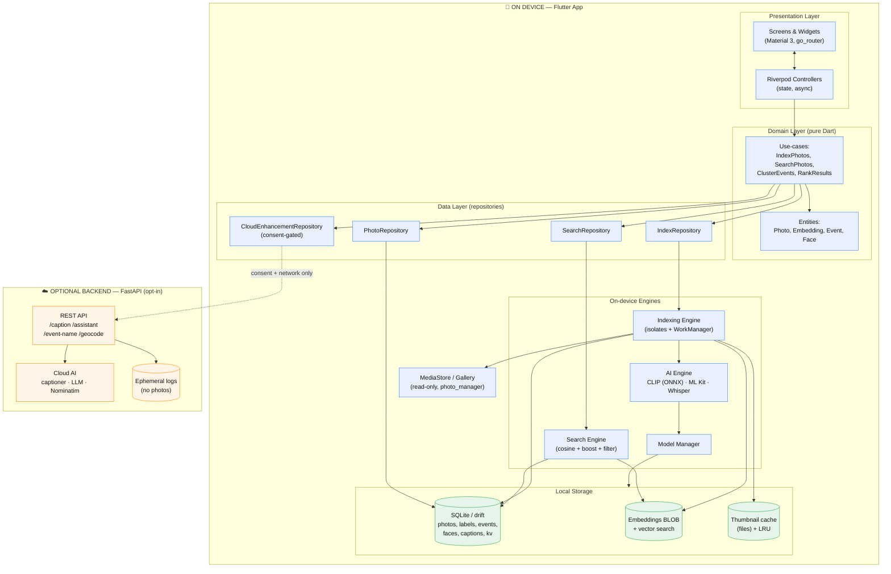
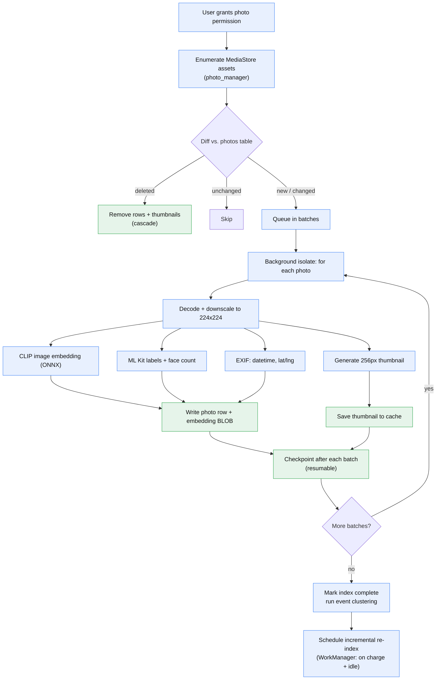
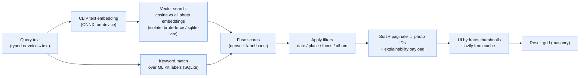
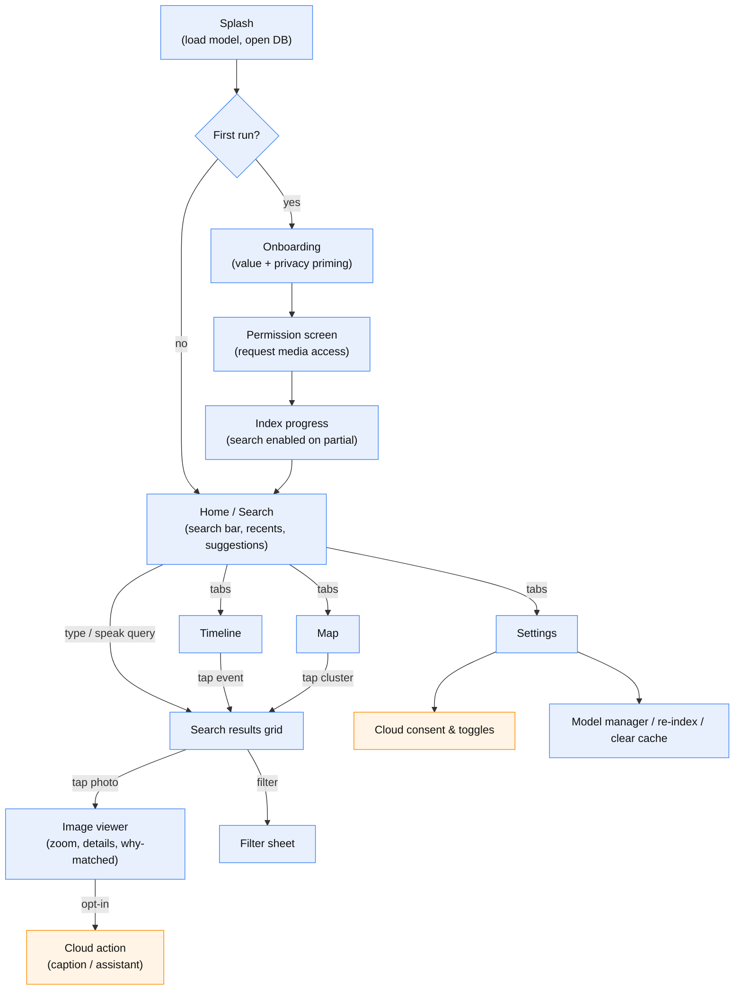
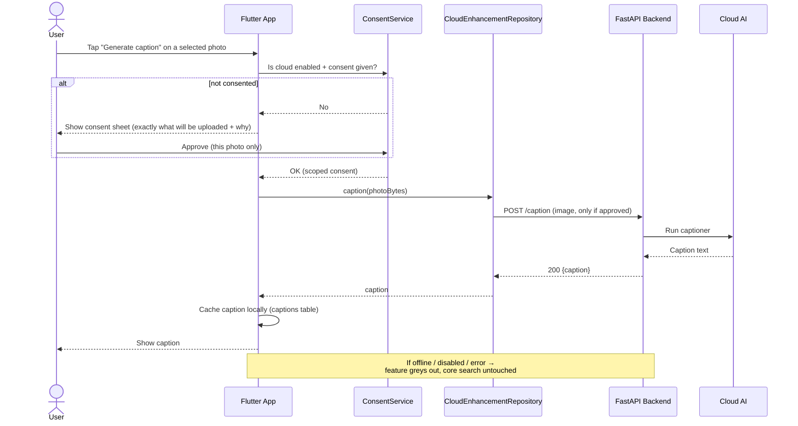
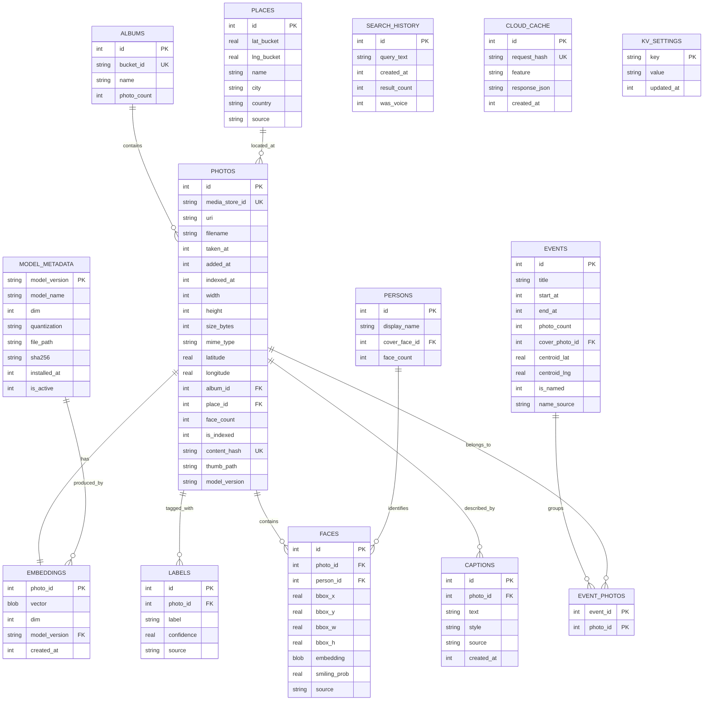
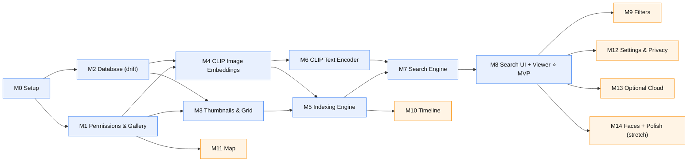

# PixelSearch Mobile — Final-Year Project Implementation Handbook

**Project:** PixelSearch — Privacy-First, AI-Powered Semantic Photo Retrieval (Mobile Edition)
**Degree:** B.E. Information Technology, University of Mumbai (Academic Year 2025–26)
**Team:** Mohit, Rudra Dalvi, Sameed Mulla, Adarsh Yadav (4 members)
**Platform:** Android-first (iOS-ready cross-platform codebase)
**Document type:** Complete technical implementation guide
**Version:** 1.0

---

## 0. How to read this handbook

This document is the single source of truth for building **PixelSearch Mobile**. It is written so that a four-person student team can implement the entire project milestone by milestone without any further planning. It is deliberately long. Read it once end-to-end, then treat each phase as a working reference during development.

The handbook follows the twelve phases you requested:

| Phase | What it gives you |
|---|---|
| 1 | Critical review of the old desktop plan — what to cut, keep, and add for mobile |
| 2 | Concrete improvements (architecture, UX, AI, pipelines, storage, caching, performance) |
| 3 | Final mobile-first tech stack with justifications for every choice |
| 4 | Full system architecture with five Mermaid diagrams |
| 5 | Complete database design (tables, columns, types, relations, indexes) |
| 6 | Full project folder structure (Flutter app + optional backend) |
| 7 | Milestone-by-milestone build plan (M0–M14) with completion criteria |
| 8 | Per-feature deep design (workflow, FE, BE, DB, AI, perf, edge cases, testing) |
| 9 | REST API design for the optional cloud backend |
| 10 | Screen-by-screen mobile UI plan |
| 11 | Academic testing strategy |
| 12 | Consolidated summary + future enhancements |

### The one-paragraph summary of the whole project

PixelSearch Mobile is an Android app (built in **Flutter**) that lets a user search their own photo gallery with natural language — *"beach trip at sunset"*, *"my dog on the sofa"*, *"birthday cake"* — and get ranked results **in under two seconds, fully offline, with no photo ever leaving the phone**. It does this by running a small **CLIP-family vision-language model on-device** to turn every photo and every text query into a 512-dimensional vector, then finding the closest photo vectors to the query vector. Everything privacy-critical (scanning the gallery, generating embeddings, storing them, searching, timeline, map) happens **on the device**. A small, **optional** FastAPI backend adds heavy "nice-to-have" intelligence (rich AI captions, a conversational search assistant, smart event names, place-name lookup) — but only for content the user explicitly consents to send, and the app is fully useful with the backend switched off.

### The three design principles that govern every decision below

1. **On-device is the product, not a feature.** The privacy promise *is* PixelSearch's identity. If a feature would force photos to a server to work at all, it is redesigned, made optional, or cut.
2. **Realistic for four students in one academic year.** We aggressively prefer mobile-native, well-maintained, pre-trained components (Flutter + Google ML Kit + a ready CLIP export) over research-grade stacks that are impressive on paper but fragile in a viva demo.
3. **Demo-stability over feature-count.** A rock-solid core (index → search → view → timeline → map) that never fails in front of examiners beats eight half-working AI modules. Advanced modules are layered on *after* the core is stable and can each be disabled without breaking anything.

---

## Table of contents

- [PHASE 1 — CRITICAL REVIEW OF THE PROJECT](#phase-1--critical-review-of-the-project)
- [PHASE 2 — IMPROVING THE PROJECT](#phase-2--improving-the-project)
- [PHASE 3 — FINAL TECH STACK](#phase-3--final-tech-stack)
- [PHASE 4 — SYSTEM ARCHITECTURE](#phase-4--system-architecture)
- [PHASE 5 — DATABASE DESIGN](#phase-5--database-design)
- [PHASE 6 — PROJECT STRUCTURE](#phase-6--project-structure)
- [PHASE 7 — IMPLEMENTATION PLAN (MILESTONES)](#phase-7--implementation-plan-milestones)
- [PHASE 8 — FEATURE DESIGN](#phase-8--feature-design)
- [PHASE 9 — API DESIGN](#phase-9--api-design)
- [PHASE 10 — MOBILE UI PLAN](#phase-10--mobile-ui-plan)
- [PHASE 11 — TESTING PLAN (academic strategy)](#phase-11--testing-plan-academic-strategy)
- [PHASE 12 — FINAL IMPLEMENTATION HANDBOOK (CONSOLIDATION)](#phase-12--final-implementation-handbook-consolidation)

# PHASE 1 — CRITICAL REVIEW OF THE PROJECT

This section reviews the **original synopsis** (fully-local desktop app with eight heavy AI modules) and the **PixelSearch 2.0 PRD** (local core + optional cloud extras, still desktop/web) against the new reality: **a premium mobile app**. The goal is not to follow either document blindly, but to keep what is excellent, fix what does not survive the move to a phone, and add what mobile demands.

## 1.1 What the original documents got right (keep these)

- **The core thesis is outstanding and still valid.** "Personal galleries have 10k–100k photos; chronological/keyword browsing fails; cloud semantic search is powerful but privacy-invasive; therefore build private, on-device, natural-language photo search." On mobile this thesis is *stronger*, because the gallery physically lives on the phone and users are most privacy-sensitive about the camera roll. **Keep it unchanged.**
- **CLIP + vector search as the retrieval backbone.** Embedding photos and queries into a shared space and doing nearest-neighbour search is exactly the right approach and is now proven on-device by real privacy apps (e.g., Ente's "Magic Search" runs CLIP on the edge via clip.cpp/GGML). **Keep it.**
- **Hybrid retrieval idea (dense + sparse).** The synopsis's instinct to combine CLIP similarity with keyword signals over tags/captions is good and improves recall on out-of-distribution photos. We keep a **mobile-appropriate version** of it (dense CLIP + lightweight keyword boost over ML Kit labels).
- **The PRD's central move — "local core, cloud extras, explicit consent."** This is the correct architecture philosophy and maps perfectly onto mobile. We adopt it wholesale and make the local/cloud boundary a first-class, visible part of the UI.
- **Incremental indexing, timeline clustering, map view.** All three are keepers and are cheap enough to run on-device.

## 1.2 Outdated ideas and things that do not survive the move to mobile

| Original idea | Why it fails on mobile | What we do instead |
|---|---|---|
| **React.js desktop web UI + FastAPI backend as the app** | A web UI is not a "premium mobile experience"; a mandatory backend breaks the offline/privacy promise and the demo dies without a server. | **Flutter native app**; the FastAPI backend becomes *optional* and only serves opt-in extras. |
| **YOLOv8 running locally for object tags** | YOLOv8 is heavy to run per-photo across a whole gallery on a phone; AGPL-3.0 licence is also awkward for distribution. | **Google ML Kit Image Labeling + Object Detection** — on-device, mobile-optimised, battery-aware, free. |
| **BLIP-2 captioning every image at index time** | BLIP-2 is ~3–4B params. Running it on every photo on a phone is completely infeasible (RAM, time, battery, thermal). | **Cut from the core.** Rich captioning becomes an **opt-in cloud** feature for *selected* photos only. |
| **Mistral-7B on-device for voice/conversation** | A 7B model (~4 GB even at 4-bit) will not co-exist with indexing on a mid-range phone. | **Cut from on-device.** Conversational assistant becomes **opt-in cloud** (text only). |
| **FaceNet + MTCNN + DeepFace stack (faces + emotion)** | Three separate heavyweight models; privacy-sensitive; hard to run and test on a phone in one year. | **Optional stretch** using **ML Kit Face Detection** + a small MobileFaceNet embedding + simple clustering. Emotion downgraded to "smiling probability" or dropped. |
| **FAISS IVF-PQ as the vector index** | FAISS is a desktop/server C++ library; it is not a natural mobile dependency and IVF-PQ is overkill at personal-gallery scale. | **On-device vector search**: brute-force cosine in an isolate for the MVP (milliseconds at 5–20k photos), upgradeable to **sqlite-vec** or **ObjectBox HNSW** for very large galleries. Framed as "the mobile analog of FAISS." |
| **MoviePy highlight-reel MP4 generation** | Server-side video encoding library; heavy and irrelevant on-device; high demo risk. | **Cut from core.** Optional future enhancement via native video APIs. |
| **D3.js timeline + force-directed graph, Leaflet.js map** | Web visualisation libraries; not how you build a native mobile screen. | **Flutter-native**: `fl_chart`/custom widgets for timeline, `flutter_map` (+ marker clustering) for maps. |
| **Whisper (base/small) as a local pillar** | Whisper base on-device is doable via whisper.cpp but too slow to be a *core pillar*; text search must be primary. | Voice = **optional convenience layer** via `whisper.cpp` (tiny/base) or native STT; **text search is always the default**. |
| **Explainable search via CLIP attention maps** | Extracting/visualising attention maps on-device is research-grade and fragile for a demo. | **Simplified**: show the matched ML Kit labels + similarity score as the "why" (a lightweight, honest explanation). Full attention maps = optional stretch. |

## 1.3 Unnecessary complexity to remove (protect the timeline and the demo)

- **Eight advanced AI modules in scope from day one.** This is the single biggest risk in the original plan. We reduce the *committed* scope to a stable core plus **two** advanced modules (Timeline, Map), and treat everything else as clearly-ranked stretch goals that can be dropped without weakening the thesis.
- **Two heavyweight LLMs (Mistral-7B) + two captioners (BLIP-2) + three face models.** Collapsed to: one on-device CLIP model, ML Kit for tags/faces, and *optional* cloud LLM/captioner.
- **Server round-trips for core search.** Removed entirely. Core search never touches a network.
- **BM25 as a full second retrieval engine.** Downgraded to a lightweight keyword-boost over stored labels (a `LIKE`/FTS query in SQLite), which captures 90% of the benefit at 10% of the effort on mobile.
- **Benchmark ambitions (100k-image galleries, Precision@5 on Flickr30k/MS-COCO, LFW, AffectNet, a conference paper).** Keep a *right-sized* evaluation (see Phase 11): a labelled 500–1,000 image test set, Precision@5 / Recall@10, latency and indexing-throughput measurements on real phones. A conference paper is a fine *optional* aspiration, not a project dependency.

## 1.4 Missing features and user flows the old documents never addressed

Because the originals were desktop-first, they silently omit things a mobile app **must** have:

**Missing mobile-platform essentials**
- **Photo permission flows** for Android 13+ (granular `READ_MEDIA_IMAGES`) and Android 14+ **partial "Selected photos" access** (`READ_MEDIA_VISUAL_USER_SELECTED`), plus graceful "limited access" handling.
- **On-device thumbnail generation + caching.** A gallery grid is unusable without fast thumbnails; the originals assume a desktop filesystem.
- **HEIC/HEIF support** (iPhone-origin photos are common even on Android via sharing) and mixed formats.
- **Background, resumable, battery-aware indexing.** Indexing 20k photos cannot block the UI and must survive the app being backgrounded; must pause on low battery / resume on charge.
- **Incremental re-indexing driven by MediaStore changes** (new/deleted/edited photos) rather than a manual desktop "rescan".
- **Low-storage and low-RAM handling**, thermal throttling, and "app killed mid-index" recovery.
- **Model provisioning on first run** (bundle vs download the CLIP model; verify integrity).

**Missing user flows**
- **Onboarding + value-first permission priming** (explain *why* before the OS dialog).
- **First-index progress experience** (how many done, ETA, pause/resume, "search works on what's indexed so far").
- **Consent flow** for every cloud action (what exactly is uploaded, why, and a clear on/off).
- **"No results" recovery** (spelling, suggestions, "search anyway on labels", broaden filters).
- **Search history & quick re-run**, recent queries, and suggested queries on an empty search screen.
- **Share/export flow** ("find → select → share to WhatsApp/Drive").
- **Settings** for privacy mode, model management, cache clearing, re-index, and cloud feature toggles.

**Missing "premium experience" expectations (explicit new requirement)**
- Material 3 (Material You) theming with dynamic colour and full dark mode.
- Hero/shared-element transition when opening a photo, pinch-zoom + swipe-to-dismiss image viewer.
- Staggered/masonry result grid, shimmer skeleton loaders, haptic feedback, smooth 60/120 fps scrolling.

## 1.5 Architecture, AI, and library improvements (summary — detailed in Phase 2 & 3)

- **Architecture:** move from "thin client + fat server" to **fat on-device client + optional thin enhancement server**. Adopt a **feature-first, layered** Flutter architecture (presentation / domain / data) with **Riverpod** for state and the **repository pattern** to hide whether data is local or cloud.
- **AI:** replace the six-model local zoo with **one CLIP-family model (on-device) + ML Kit (tags/faces) + optional cloud LLM**. Keep the *hybrid retrieval* idea in a mobile-cheap form.
- **Indexing:** isolate-based, batched, resumable, incremental, charge/idle-aware (Android WorkManager).
- **Storage:** SQLite (via `drift`) for metadata + embeddings-as-BLOB; a file-based **thumbnail cache**; an in-memory **LRU**; optional vector index (sqlite-vec/ObjectBox) for scale.
- **Libraries:** `photo_manager`, `permission_handler`, `onnxruntime`/`fonnx`, `google_mlkit_*`, `drift`, `flutter_map`, `fl_chart`, `flutter_riverpod`, `workmanager`, `whisper` (optional). Full table in Phase 3.

## 1.6 What is unrealistic for an FYP — and the honest, defensible scope

**Unrealistic (drop or make optional):** all-local BLIP-2/Mistral/DeepFace/FaceNet/MoviePy; attention-map explainability; 100k-image benchmarking; native iOS in v1; a published paper as a deliverable.

**Realistic and genuinely impressive (commit to this):** a polished Flutter Android app that indexes a real 5,000–20,000-photo gallery **on the device**, answers natural-language queries **offline in under 2 seconds**, shows a beautiful result grid and image viewer, groups photos into a **timeline** and onto a **map**, all with a visible, trustworthy **privacy model** — plus an **optional** cloud layer demonstrating full-stack skills (FastAPI) for captions, a chat-style search assistant, and smart event names. This is a stronger, more defensible project than the original because every claimed feature actually works in the demo.

---

# PHASE 2 — IMPROVING THE PROJECT

The core idea is unchanged: **privacy-first semantic photo retrieval.** Below are concrete, non-over-engineered improvements a student team can actually implement.

## 2.1 Architecture improvements

**Adopt a feature-first, three-layer Flutter architecture.** Each feature (search, timeline, map, indexing, settings, cloud) is a self-contained folder with three layers:

- **Presentation** — Flutter widgets/screens + Riverpod controllers (state).
- **Domain** — plain-Dart use-cases and entities (no Flutter, no SQL). This is where "rank results", "cluster events", "cosine similarity" live, so they are unit-testable in isolation.
- **Data** — repositories + data sources (SQLite, ML Kit, ONNX runtime, MediaStore, backend API). Repositories expose a clean interface so the domain never knows if data came from the phone or the cloud.

Why this matters for a *team*: four people can own different features in parallel with minimal merge conflicts, and the local/cloud boundary is enforced in one place (the repository), which is exactly the PRD's key requirement.

**Make the local/cloud boundary explicit in code, not just in the UI.** All cloud calls go through a single `CloudEnhancementRepository` guarded by a `ConsentService`. If cloud is disabled or offline, the repository returns a graceful "unavailable" result and the core app is untouched. This directly implements the non-functional requirement "a failed cloud request must never break local search."

**Run all heavy work off the UI isolate.** Embedding generation, cosine search over large sets, thumbnail decoding, and clustering run in **background isolates** (`Isolate.run` / a long-lived indexing isolate), keeping the UI at 60/120 fps.

## 2.2 User-experience improvements (the "premium" requirement)

- **Material 3 + dynamic colour + dark mode** as the baseline visual language.
- **Search-first home:** a large, always-reachable search bar; recent + suggested queries when empty; debounced search-as-you-type; voice mic affordance.
- **Result grid:** masonry/staggered layout, shimmer skeletons while thumbnails decode, similarity indicated subtly (not a noisy number on every tile).
- **Image viewer:** hero shared-element transition from grid → full screen; pinch-to-zoom, double-tap zoom, swipe-down-to-dismiss; a "details" sheet showing date, place, matched labels, and the "why this matched" explanation.
- **Indexing UX:** a calm progress card ("Indexed 3,120 / 8,004 · you can search now"), pause/resume, and a background notification, not a blocking spinner.
- **Micro-interactions:** haptic feedback on select/long-press, animated filter chips, smooth empty/error states. These small touches are what make examiners perceive "premium".

## 2.3 AI-workflow improvements

**Keep the hybrid retrieval concept, but mobile-cheap.** For each photo we store: (a) a **CLIP image embedding** (512-d) and (b) a small set of **ML Kit labels** (e.g., "beach", "dog", "cake") with confidences. Search combines:

1. **Dense signal:** cosine similarity between the query's CLIP text embedding and every photo embedding.
2. **Sparse boost:** if query terms match stored labels (SQLite FTS/`LIKE`), add a small score bonus.
3. **Filters:** date, place, has-faces, album applied as constraints.
4. **Rank & page** the fused scores.

This reproduces the synopsis's "local + global feature fusion" benefit (dense CLIP = global, labels = local attributes) without YOLO or BM25 machinery.

**Choose the right on-device CLIP.** Use a compact CLIP-family model exported to **ONNX** (or TFLite): **MobileCLIP-S1/S2** (Apple, CVPR 2024 — designed for exactly this) or a quantised **CLIP ViT-B/32**. Both yield ~512-d embeddings and run in tens of milliseconds per image on a mid-range phone. Image and text share the space, so the same model serves indexing and querying.

**Handle CLIP text tokenisation up front (known gotcha).** CLIP needs a byte-pair-encoding tokenizer at query time. Bundle the BPE vocab/merges with the app and either use a Dart tokenizer or the runtime's tokenizer op. This is a small but real task — it is called out explicitly in Milestone M6 so it is not discovered late.

**Use ML Kit for the "local attribute" and face work** instead of YOLO/FaceNet/DeepFace: `image_labeling` (scene/object tags), `object_detection` (optional bounding boxes), `face_detection` (counts + smiling probability + optional embeddings for People grouping). All on-device, tuned for battery.

## 2.4 Indexing-pipeline improvements

A robust, resumable, incremental pipeline (full spec in Phase 8):

```
enumerate MediaStore assets (photo_manager)
      │  (diff against `photos` table → new / changed / deleted)
      ▼
for each NEW/CHANGED photo, in batches, in a background isolate:
      decode + downscale (e.g., 224×224 for CLIP)
      → CLIP image embedding (ONNX)      ─┐
      → ML Kit labels + face count        ├─ write row + embedding BLOB (SQLite)
      → EXIF: datetime, lat/lng           ─┘
      → generate + cache a thumbnail (file)
      ▼
update index progress; checkpoint after every batch (resumable)
      ▼
schedule incremental re-index via WorkManager (on charge + idle)
```

Key improvements over the original: **batching** (amortise model load and I/O), **checkpointing** (survive app kill), **diffing** against MediaStore (true incremental), **charge/idle scheduling** (battery-friendly), and **"search works on the partial index"** (no need to wait for 100%).

## 2.5 Search-pipeline improvements

```
query text ─→ CLIP text embedding (ONNX, on-device)
           ─→ cosine vs. all photo embeddings (isolate; brute-force or sqlite-vec)
           ─→ keyword boost from ML Kit labels (SQLite)
           ─→ apply filters (date / place / faces / album)
           ─→ fuse + sort + paginate ─→ return photo IDs
UI hydrates thumbnails lazily from the thumbnail cache
```

Improvements: everything on-device, **sub-2-second** target preserved, **lazy thumbnail hydration** so the grid paints instantly, and an **explainability payload** (top matched labels + score) returned with each result for the "why this matched" sheet.

## 2.6 Storage-strategy improvements

- **SQLite via `drift`** (type-safe, compile-checked queries, easy migrations) as the single metadata store.
- **Embeddings stored as `BLOB`** (`Float32List`, 512×4 = 2,048 bytes/photo → ~2 MB per 1,000 photos; ~40 MB at 20k — trivial).
- **Thumbnails cached as files** in the app's cache dir (e.g., 256 px WebP/JPEG), keyed by photo ID; never re-decode originals for the grid.
- **A small `settings`/`kv` table** for model version, index checkpoint, consent flags.
- **Optional vector index** (`sqlite-vec` extension or ObjectBox HNSW) enabled only if a gallery exceeds a threshold (e.g., 30k photos) — otherwise brute-force is simpler and fast enough.

## 2.7 Caching improvements (three levels)

1. **In-memory LRU** for decoded thumbnails currently on screen (fast scroll).
2. **On-disk thumbnail cache** (persistent across launches).
3. **Embedding cache = the SQLite BLOBs** (compute once, reuse forever unless the model version changes; a model upgrade bumps a `model_version` and triggers re-embedding).
4. **Cloud-result cache:** any caption/event-name returned by the backend is stored locally and never re-requested.

## 2.8 Performance improvements

- **Quantised models** (int8/4-bit) to cut model size and inference time.
- **Batch inference** during indexing; reuse the loaded ONNX session.
- **Downscale before embedding** (CLIP wants 224×224 — never feed full-res).
- **Pagination + lazy loading** in the grid; decode thumbnails on demand.
- **Isolate offloading** for embedding, search, clustering.
- **Vectorised cosine** (operate on `Float32List` with tight loops / SIMD-friendly code) and, at scale, an ANN index.
- **Debounce** search input; cancel superseded queries.

## 2.9 Maintainability & modularity improvements

- **Feature-first folders** + **repository pattern** + **Riverpod** = testable, parallelisable, low-merge-conflict.
- **Every advanced module is a plug-in feature** behind a flag; disabling it cannot break the core.
- **Domain layer has zero Flutter/SQL imports**, so ranking/clustering logic is pure and unit-tested.
- **One config file** (`app_config.dart`) for model paths, thresholds, backend base URL, feature flags.
- **Clear coding conventions** + CI (format, analyze, test) from Milestone M0.

> **Guardrail against over-engineering:** we deliberately *do not* add a plugin system, multi-model routing, custom ANN implementations, or a microservice backend. Brute-force cosine, one CLIP model, ML Kit, SQLite, and a single FastAPI service are enough. Complexity is added only when a measured need appears (e.g., ANN only past ~30k photos).

---

# PHASE 3 — FINAL TECH STACK

Everything below is chosen to be **mobile-first, on-device-capable, well-maintained in 2026, and realistic for four students.** Where you asked for a comparison, the decision and the reasoning are given.

## 3.1 Mobile framework — **Flutter** (decision) vs React Native

**Decision: Flutter (Dart).**

| Criterion | Flutter | React Native | Why it matters here |
|---|---|---|---|
| Raw UI performance (huge image grids, 120 fps) | Compiles to native ARM; renders via its own engine — excellent | JS bridge/Fabric; good but heavier for very large media grids | A photo app *is* a giant scrolling grid |
| Heavy background compute (embedding thousands of photos) | **Dart isolates** — clean, first-class multithreading | Workers/native modules — more plumbing | Indexing is the hardest performance problem |
| On-device ML | `onnxruntime`, `fonnx`, `tflite_flutter`, full `google_mlkit_*` suite | ExecuTorch, `react-native-fast-tflite`, ML Kit wrappers | Both work; Flutter's ML Kit + ONNX story is very mature |
| Premium animations/transitions | Best-in-class (hero, implicit animations, custom paint) | Good (Reanimated) | "Premium experience" is an explicit requirement |
| Single codebase → Android now, iOS later | Yes, one codebase | Yes | Android-first, iOS-ready |
| Team's existing React skill | Small learning curve (Dart is easy) | Reuses React knowledge | The one point favouring RN |

**Why Flutter wins for *this* app:** the two hardest engineering problems are (1) buttery scrolling over thousands of image thumbnails and (2) embedding thousands of photos in the background without freezing the UI. Flutter's native rendering and **isolate** model are materially better suited to both, and its animation system makes the "premium" requirement easy. The team's React background is a real but minor cost — Dart is straightforward and the payoff in polish and performance is large. (If the team had *zero* time to learn Dart, React Native would be the fallback; it is a good framework, just not the best fit here.)

## 3.2 State management — **Riverpod** (decision) vs Bloc / Provider

**Decision: Riverpod (`flutter_riverpod` + `riverpod_generator`).**

- **Riverpod** is the modern successor to Provider (same author), compile-safe, testable without a `BuildContext`, and its `AsyncNotifier`/`FutureProvider` model fits "load index status", "run search", "stream indexing progress" naturally. **This is our choice.**
- **Bloc** is excellent for large teams that want strict, event-driven, highly-traceable state — but it is more boilerplate than four students need here. Recommend Bloc only if the team already loves it.
- **Provider** is fine but older; Riverpod supersedes it.
- (React/Redux/Zustand are not applicable — those are React-world; the Flutter analog is Riverpod/Bloc.)

## 3.3 On-device AI stack

| Role | Choice | Notes |
|---|---|---|
| **Image + text embeddings (core)** | **CLIP-family model in ONNX**: MobileCLIP-S1/S2 *or* quantised CLIP ViT-B/32 | 512-d shared space; runs on-device; image side for indexing, text side for queries |
| **ONNX runtime for Flutter** | `onnxruntime` (gtbluesky) or `fonnx` (Telosnex) | Loads the CLIP encoders; reuse one session; run in an isolate |
| **(Alt) TFLite runtime** | `tflite_flutter` | Use if you prefer a TFLite export of CLIP/MobileCLIP |
| **Object/scene tags (local attributes)** | **Google ML Kit Image Labeling** (`google_mlkit_image_labeling`) + optional **Object Detection** | Replaces YOLOv8; on-device, battery-tuned |
| **Faces (optional stretch)** | **ML Kit Face Detection** (`google_mlkit_face_detection`) + small **MobileFaceNet** (TFLite) for embeddings | Replaces MTCNN/FaceNet/DeepFace; clustering via threshold/union-find or DBSCAN |
| **Voice → text (optional)** | **whisper.cpp** via `whisper_flutter_new`/`whisper_kit` (tiny/base) *or* native STT (`speech_to_text`) | True on-device with whisper.cpp; note `speech_to_text` may use the OS service. Text search is always primary. |
| **Vector search** | **Brute-force cosine** (MVP) → **sqlite-vec** or **ObjectBox HNSW** (scale) | The mobile analog of FAISS IVF-PQ |

**Cloud-tier AI (optional backend, opt-in only):** rich captioning (BLIP-family or a vision-LLM/API), conversational search assistant (an LLM via API or local Ollama), smart event naming (LLM over event text summaries). None are required for the app to work.

## 3.4 Backend (optional cloud tier) — as you specified

| Component | Choice | Purpose |
|---|---|---|
| Web framework | **FastAPI** (+ **Uvicorn**) | REST endpoints for opt-in extras |
| Language | **Python 3.11+** | AI ecosystem |
| Validation | **Pydantic v2** | Request/response schemas |
| ORM / persistence | **SQLAlchemy 2.x** + SQLite (or Postgres) | Only for optional logging/rate-limit/cache; **stores no user photos** |
| AI libs | `transformers`/`torch` for captioning, an LLM client, `httpx` for Nominatim proxy | Behind consent, stateless where possible |
| Deploy (for the demo) | Local machine / a small VM / free tier; reachable over LAN or a tunnel | The app defaults to backend **off** |

**Design rule:** the backend is a **stateless enhancement service**. It receives only what the user consented to send (a selected photo for captioning, or *text only* for assistant/event-naming), returns a result, and ideally persists nothing beyond ephemeral logs. This preserves the privacy thesis while still letting the team demonstrate FastAPI/Pydantic/SQLAlchemy skills (good for an IT degree).

## 3.5 Storage & data

| Need | Choice | Why |
|---|---|---|
| Metadata DB | **SQLite via `drift`** | Type-safe, migrations, FTS available; one engine to reason about |
| Embeddings | **BLOB column** (`Float32List`) in SQLite | Simple, compact (~2 KB/photo), fast to load into an isolate |
| Thumbnail cache | **Files** in app cache dir (256 px) + `flutter_cache_manager` patterns | Grid performance |
| In-memory cache | LRU of decoded thumbnails | Smooth scroll |
| Vector index (optional) | **sqlite-vec** extension or **ObjectBox** | ANN only when galleries get large |
| Key/value (settings, checkpoints, consent) | `drift` table or `shared_preferences` | Small, simple state |

## 3.6 Maps — **flutter_map + OpenStreetMap** (decision) vs Google Maps

**Decision: `flutter_map` with OpenStreetMap tiles**, plus `flutter_map_marker_cluster` for clustering.

- **OSM/`flutter_map`** — free, **no API key**, no per-map-load billing, no Google account dependency, and it aligns with the **privacy-first** identity (no Google Maps telemetry for simply browsing your own photos on a map). **This is our choice.**
- **Google Maps (`google_maps_flutter`)** — slicker default styling and traffic/places, but needs an API key + billing project, adds a commercial dependency, and is off-brand for a privacy app. Choose it only if the team specifically wants Google's map styling.
- **Reverse geocoding** (coords → place name) stays **optional** and goes through the backend proxying **Nominatim** (rate-limited) or an offline dataset — never required for the map to render.

## 3.7 Supporting Flutter packages (the working set)

| Concern | Package(s) |
|---|---|
| Gallery access & thumbnails | `photo_manager`, `photo_manager_image_provider` |
| Permissions | `permission_handler` |
| On-device inference | `onnxruntime` / `fonnx` (and/or `tflite_flutter`) |
| ML Kit | `google_mlkit_image_labeling`, `google_mlkit_object_detection`, `google_mlkit_face_detection` |
| Database | `drift`, `sqlite3_flutter_libs`, (optional `sqlite_vec`/`objectbox`) |
| State management | `flutter_riverpod`, `riverpod_annotation`, `riverpod_generator` |
| Background work | `workmanager`, `flutter_background_service` (if needed) |
| Maps | `flutter_map`, `flutter_map_marker_cluster`, `latlong2` |
| Charts/timeline | `fl_chart` (or custom widgets) |
| Image viewing | `photo_view`, hero animations (built-in) |
| EXIF | `native_exif` / `exif` (plus `photo_manager` lat/lng) |
| Networking (cloud tier) | `dio` (+ `retrofit` optional) |
| Voice (optional) | `whisper_flutter_new`/`whisper_kit` or `speech_to_text` |
| Utils/UX | `intl`, `shimmer`, `cached_network_image`, `share_plus`, `path_provider`, `flutter_animate` |
| Routing | `go_router` |
| Testing | `flutter_test`, `mocktail`, `integration_test`, `patrol` (optional) |

## 3.8 Tooling & DevOps (right-sized for a student team)

- **Version control:** Git + GitHub, feature-branch workflow, PR reviews between teammates.
- **CI:** GitHub Actions running `flutter analyze`, `dart format --set-exit-if-changed`, `flutter test` on every PR (add `flutter build apk --debug` to catch build breaks).
- **Project management:** GitHub Projects/Issues mapped to the milestones in Phase 7.
- **Crash/log (dev only, offline-friendly):** local logging; avoid third-party analytics to stay on-brand for privacy (optional self-hosted Sentry if desired).
- **Backend:** `pip`/`uv` + `venv`, `ruff` + `black`, `pytest`; a `Dockerfile` for reproducible demo hosting.

## 3.9 Stack at a glance

```
┌───────────────────────────── ON DEVICE (Flutter / Dart) ─────────────────────────────┐
│  UI: Material 3 · go_router · Riverpod                                                 │
│  Features: Onboarding · Indexing · Search · Viewer · Timeline · Map · Settings · Cloud │
│  AI (on-device): CLIP (ONNX) · ML Kit (labels/faces) · [whisper.cpp voice, optional]   │
│  Vector search: brute-force cosine → sqlite-vec / ObjectBox (scale)                    │
│  Data: drift/SQLite (metadata + embedding BLOBs) · file thumbnail cache · LRU          │
│  Gallery: photo_manager (MediaStore) · permission_handler · EXIF                       │
│  Background: isolates · WorkManager (incremental, charge/idle-aware)                   │
└───────────────────────────────────────────────────────────────────────────────────────┘
                              ▲ opt-in, consent-gated, text/selected-photo only
                              │  (app fully works with this OFF)
┌───────────────────────── OPTIONAL CLOUD (FastAPI / Python) ──────────────────────────┐
│  Endpoints: /caption · /assistant · /event-name · /geocode                            │
│  Pydantic v2 validation · SQLAlchemy (ephemeral logs only, no photos) · Nominatim proxy│
└───────────────────────────────────────────────────────────────────────────────────────┘
```

# PHASE 4 — SYSTEM ARCHITECTURE

PixelSearch Mobile is a **fat on-device client** with an **optional thin enhancement server**. This section gives the component model and the five required flow diagrams. Every diagram below is valid Mermaid and will render in GitHub, VS Code, Obsidian, or any Mermaid viewer.

## 4.1 Component overview

| Component | Runs on | Responsibility |
|---|---|---|
| **Mobile App (Flutter)** | Device | All UI, orchestration, and the entire private core |
| **Indexing Engine** | Device (isolates + WorkManager) | Enumerate gallery, embed photos, extract labels/EXIF/faces, cache thumbnails, checkpoint |
| **AI Engine (on-device)** | Device | CLIP encoders (ONNX), ML Kit labelers/face detector, optional whisper.cpp |
| **Search Engine** | Device (isolate) | Embed query, vector search, keyword boost, filter, rank, paginate |
| **Database (SQLite/drift)** | Device | Photos, labels, events, faces, captions, settings, history |
| **Vector store** | Device | Embedding BLOBs + cosine search (→ sqlite-vec/ObjectBox at scale) |
| **Image Storage** | Device | Original photos (read-only via MediaStore) + generated thumbnail cache |
| **Model Manager** | Device | Provision/verify/activate CLIP model files; track `model_version` |
| **Settings & Consent** | Device | Privacy mode, feature flags, cloud toggles, cache controls |
| **Optional Cloud Services (FastAPI)** | Server | Caption, assistant, event-name, geocode — consent-gated, stateless |

## 4.2 System Architecture diagram



## 4.3 Indexing Flow diagram



## 4.4 Search Flow diagram



## 4.5 Mobile User Flow diagram



## 4.6 Cloud Feature Flow diagram (opt-in, consent-gated)



## 4.7 Component deep-notes

- **Model Manager** decides whether the CLIP model is **bundled** in the APK (simplest; MobileCLIP-S1/quantised ViT-B/32 are tens of MB) or **downloaded on first run** (smaller APK; needs a one-time network fetch + SHA-256 verify). Default: **bundle** for demo reliability. It also stamps a `model_version`; changing it triggers re-embedding.
- **Settings & Consent** is the single gate for anything leaving the device. Consent is **scoped** (per feature, and for captioning, per photo) and revocable. Privacy mode = "airplane for your photos": disables all cloud calls globally.
- **Optional Cloud Services** never receive raw photos except for the explicit *caption-this-selected-photo* action; the assistant and event-name features receive **derived text only** (query text, label lists, event time summaries), never images.

---

# PHASE 5 — DATABASE DESIGN

The on-device database is **SQLite**, accessed through **`drift`** (type-safe Dart). It holds all metadata, embeddings, and derived intelligence. Below: the ER diagram, then every table with columns, types, keys, indexes, and constraints, then implementation notes.

## 5.1 Entity-Relationship diagram



> **SQLite type note:** SQLite uses dynamic typing with affinities. In the specs below, `INTEGER` timestamps are Unix epoch **milliseconds** (`int`), `REAL` is a 64-bit float, `TEXT` is UTF-8, `BLOB` is raw bytes. Booleans are stored as `INTEGER` 0/1. In `drift` these map to `IntColumn`, `RealColumn`, `TextColumn`, `BlobColumn`, `BoolColumn`.

## 5.2 Table-by-table specification

### `photos` — the master record (one row per indexed image)

| Column | Type | Constraints | Purpose |
|---|---|---|---|
| `id` | INTEGER | PK, AUTOINCREMENT | Internal id |
| `media_store_id` | TEXT | NOT NULL, UNIQUE | MediaStore/asset id from `photo_manager` |
| `uri` | TEXT | NOT NULL | Content URI / path to the original |
| `filename` | TEXT | | Display name |
| `taken_at` | INTEGER | INDEX | Capture time (EXIF or file date), epoch ms |
| `added_at` | INTEGER | | When added to the device |
| `indexed_at` | INTEGER | | When PixelSearch indexed it |
| `width` | INTEGER | | Pixels |
| `height` | INTEGER | | Pixels |
| `size_bytes` | INTEGER | | File size |
| `mime_type` | TEXT | | e.g. image/jpeg, image/heic |
| `latitude` | REAL | NULL | EXIF GPS |
| `longitude` | REAL | NULL | EXIF GPS |
| `album_id` | INTEGER | FK→albums.id, NULL, ON DELETE SET NULL | Source album/bucket |
| `place_id` | INTEGER | FK→places.id, NULL, ON DELETE SET NULL | Resolved place bucket |
| `face_count` | INTEGER | DEFAULT 0 | # faces (ML Kit) for the has-faces filter |
| `is_indexed` | INTEGER | DEFAULT 0, INDEX | 0=pending, 1=done (partial-index search) |
| `content_hash` | TEXT | UNIQUE | Dedup + change detection (hash of bytes or id+mtime+size) |
| `thumb_path` | TEXT | | Cached thumbnail file path |
| `model_version` | TEXT | | Model that produced this row's embedding |

**Indexes:** `idx_photos_taken_at(taken_at)`, `idx_photos_geo(latitude, longitude)`, `idx_photos_album(album_id)`, `idx_photos_place(place_id)`, `idx_photos_is_indexed(is_indexed)`, unique on `media_store_id`, unique on `content_hash`.

### `embeddings` — CLIP vectors (1:1 with photos, kept separate for re-embedding)

| Column | Type | Constraints | Purpose |
|---|---|---|---|
| `photo_id` | INTEGER | PK, FK→photos.id, ON DELETE CASCADE | Owner |
| `vector` | BLOB | NOT NULL | 512× float32 = 2,048 bytes (`Float32List`) |
| `dim` | INTEGER | NOT NULL, CHECK(dim>0) | Embedding dimension (512) |
| `model_version` | TEXT | FK→model_metadata.model_version | For cache invalidation |
| `created_at` | INTEGER | | Timestamp |

**Indexes:** PK on `photo_id`; `idx_embeddings_model(model_version)`.
**Storage note:** for the MVP the search isolate loads all vectors once into a contiguous `Float32List` and scans them; the `dim` + `model_version` guard against mixing incompatible vectors.

### `labels` — ML Kit tags (M per photo) → the sparse/keyword signal

| Column | Type | Constraints |
|---|---|---|
| `id` | INTEGER | PK |
| `photo_id` | INTEGER | FK→photos.id, ON DELETE CASCADE, INDEX |
| `label` | TEXT | NOT NULL |
| `confidence` | REAL | CHECK(confidence BETWEEN 0 AND 1) |
| `source` | TEXT | 'mlkit_label' \| 'mlkit_object' |

**Indexes:** `idx_labels_photo(photo_id)`, `idx_labels_label(label)`; optionally an **FTS5** virtual table `labels_fts(label, photo_id)` for fast keyword boost.

### `albums`

| Column | Type | Constraints |
|---|---|---|
| `id` | INTEGER | PK |
| `bucket_id` | TEXT | UNIQUE (MediaStore bucket) |
| `name` | TEXT | |
| `photo_count` | INTEGER | |

### `places` — coarse location buckets (privacy-friendly)

| Column | Type | Constraints |
|---|---|---|
| `id` | INTEGER | PK |
| `lat_bucket` | REAL | Rounded lat (e.g., 2–3 dp) |
| `lng_bucket` | REAL | Rounded lng |
| `name` | TEXT | NULL until reverse-geocoded |
| `city` | TEXT | NULL |
| `country` | TEXT | NULL |
| `source` | TEXT | 'none' \| 'nominatim' \| 'offline' |

**Index:** unique `idx_places_bucket(lat_bucket, lng_bucket)`.

### `events` — timeline clusters

| Column | Type | Constraints |
|---|---|---|
| `id` | INTEGER | PK |
| `title` | TEXT | e.g. "Event 14 · Jan 2024" or a smart name |
| `start_at` | INTEGER | Cluster start (epoch ms), INDEX |
| `end_at` | INTEGER | Cluster end |
| `photo_count` | INTEGER | |
| `cover_photo_id` | INTEGER | FK→photos.id, ON DELETE SET NULL |
| `centroid_lat` | REAL | NULL |
| `centroid_lng` | REAL | NULL |
| `is_named` | INTEGER | 0/1 (smart-named yet?) |
| `name_source` | TEXT | 'generic' \| 'cloud_llm' |

### `event_photos` — M:N junction (photo ↔ event)

| Column | Type | Constraints |
|---|---|---|
| `event_id` | INTEGER | FK→events.id, ON DELETE CASCADE |
| `photo_id` | INTEGER | FK→photos.id, ON DELETE CASCADE |

**Constraint:** composite **PK(event_id, photo_id)**; index `idx_eventphotos_photo(photo_id)`.

### `persons` — grouped identities (optional stretch)

| Column | Type | Constraints |
|---|---|---|
| `id` | INTEGER | PK |
| `display_name` | TEXT | NULL until user names them ("Rahul") |
| `cover_face_id` | INTEGER | FK→faces.id, ON DELETE SET NULL |
| `face_count` | INTEGER | |

### `faces` — detected faces (optional stretch)

| Column | Type | Constraints |
|---|---|---|
| `id` | INTEGER | PK |
| `photo_id` | INTEGER | FK→photos.id, ON DELETE CASCADE, INDEX |
| `person_id` | INTEGER | FK→persons.id, ON DELETE SET NULL, INDEX |
| `bbox_x/y/w/h` | REAL | Normalised box |
| `embedding` | BLOB | NULL (MobileFaceNet 128/192-d) |
| `smiling_prob` | REAL | NULL (ML Kit classification) |
| `source` | TEXT | 'mlkit' |

> **Privacy:** face embeddings are hashed/stored locally only and never uploaded. Faces is fully optional and can be disabled in settings.

### `captions` — cloud-generated captions (cached locally)

| Column | Type | Constraints |
|---|---|---|
| `id` | INTEGER | PK |
| `photo_id` | INTEGER | FK→photos.id, ON DELETE CASCADE, INDEX |
| `text` | TEXT | NOT NULL |
| `style` | TEXT | 'plain' \| 'instagram' \| 'hashtag' \| 'formal' |
| `source` | TEXT | 'cloud' |
| `created_at` | INTEGER | |

### `search_history`

| Column | Type | Constraints |
|---|---|---|
| `id` | INTEGER | PK |
| `query_text` | TEXT | NOT NULL |
| `created_at` | INTEGER | INDEX (desc) |
| `result_count` | INTEGER | |
| `was_voice` | INTEGER | 0/1 |

### `model_metadata` — Model Manager registry

| Column | Type | Constraints |
|---|---|---|
| `model_version` | TEXT | PK (e.g., "mobileclip_s1_int8_v1") |
| `model_name` | TEXT | |
| `dim` | INTEGER | 512 |
| `quantization` | TEXT | 'int8' \| 'fp16' \| 'none' |
| `file_path` | TEXT | Local path |
| `sha256` | TEXT | Integrity |
| `installed_at` | INTEGER | |
| `is_active` | INTEGER | 0/1 (one active model) |

### `cloud_cache` — dedup identical cloud requests

| Column | Type | Constraints |
|---|---|---|
| `id` | INTEGER | PK |
| `request_hash` | TEXT | UNIQUE |
| `feature` | TEXT | 'caption' \| 'assistant' \| 'event_name' \| 'geocode' |
| `response_json` | TEXT | |
| `created_at` | INTEGER | |

### `kv_settings` — flags & checkpoints

| Column | Type | Constraints |
|---|---|---|
| `key` | TEXT | PK |
| `value` | TEXT | JSON/string |
| `updated_at` | INTEGER | |

Typical keys: `privacy_mode`, `cloud_enabled`, `consent_caption`, `consent_assistant`, `backend_base_url`, `index_checkpoint` (last processed cursor), `last_media_generation`, `theme_mode`, `voice_enabled`.

## 5.3 Referential integrity & cascade rules

- Deleting a **photo** cascades to `embeddings`, `labels`, `faces`, `captions`, and `event_photos` (its links). `events`, `albums`, `places`, `persons` survive (their FKs on the photo side are junctions or `SET NULL`).
- Deleting an **event** cascades only to its `event_photos` rows (photos survive).
- Deleting a **person** sets `faces.person_id = NULL` (faces survive, just ungrouped).
- Enable FK enforcement in SQLite: `PRAGMA foreign_keys = ON;` (drift: set in the connection's `beforeOpen`).

## 5.4 Migration & versioning

- Use **drift schema versions**; bump on any schema change and write a migration step.
- A **model upgrade** (new `model_version`) does *not* change schema; it sets `embeddings.model_version` mismatches → the indexer re-embeds lazily (photos whose `model_version` ≠ active are re-queued).

## 5.5 The vector-storage decision (how "FAISS" becomes mobile)

- **MVP (≤ ~20–30k photos):** store vectors as BLOBs; the Search Engine loads them into one `Float32List` in an isolate and computes cosine similarity by brute force. At 20k×512 this is a few million multiply-adds — **single-digit milliseconds**. Simplest, exact, fully explainable in a viva.
- **Scale-up (large galleries):** add **`sqlite-vec`** (a SQLite extension giving KNN over vector columns) or **ObjectBox** (on-device HNSW vector index). This is the true analog of FAISS IVF-PQ and is enabled behind a threshold flag so you only pay the complexity when you need it.

---

# PHASE 6 — PROJECT STRUCTURE

Two repositories (or one monorepo with two folders): the **Flutter app** (the product) and the **optional FastAPI backend**. Structure is **feature-first** so four teammates can own features in parallel.

## 6.1 Repository layout (monorepo)

```
pixelsearch/
├── app/                      # Flutter mobile application (the product)
├── backend/                  # Optional FastAPI enhancement service
├── models/                   # Exported CLIP model + tokenizer assets (checked in or via Git LFS)
├── docs/                     # This handbook, diagrams, API docs, report
├── scripts/                  # Model export/quantise, test-set tools, benchmarks
└── README.md
```

## 6.2 Flutter app structure (`app/`)

```
app/
├── android/                          # Android platform (permissions, WorkManager, manifest)
├── ios/                              # iOS platform (kept building; not a v1 target)
├── assets/
│   ├── models/                       # clip_image.onnx, clip_text.onnx, tokenizer/bpe files
│   ├── images/                       # onboarding art, empty-state illustrations
│   └── fonts/
├── lib/
│   ├── main.dart                     # Entry: init DB, model, providers, run app
│   ├── app.dart                      # MaterialApp.router, theme, go_router config
│   │
│   ├── core/                         # Cross-cutting, feature-agnostic
│   │   ├── config/                   # app_config.dart (paths, thresholds, flags, base URL)
│   │   ├── theme/                    # Material 3 theme, colors, typography, dark mode
│   │   ├── routing/                  # go_router routes, guards (permission/index gates)
│   │   ├── di/                       # Riverpod provider wiring / overrides
│   │   ├── error/                    # Failure types, Result<T>, exception mapping
│   │   ├── utils/                    # extensions, formatters (intl), logger, debouncer
│   │   └── widgets/                  # shared UI: ShimmerTile, EmptyState, ConsentSheet
│   │
│   ├── data/                         # Data layer (implementation of repositories)
│   │   ├── db/                       # drift database, tables/, daos/, migrations
│   │   │   ├── database.dart
│   │   │   ├── tables/               # photos.dart, embeddings.dart, labels.dart, events.dart ...
│   │   │   └── daos/                 # photo_dao.dart, search_dao.dart, event_dao.dart ...
│   │   ├── gallery/                  # photo_manager wrapper (enumerate, thumbnails, EXIF)
│   │   ├── ai/                       # on-device engines
│   │   │   ├── clip/                 # onnx session, image/text encoders, bpe tokenizer
│   │   │   ├── mlkit/                # image_labeling, object_detection, face_detection
│   │   │   └── voice/               # whisper.cpp / speech_to_text wrapper (optional)
│   │   ├── vector/                   # cosine search, (sqlite-vec/objectbox adapter)
│   │   ├── thumbnails/               # thumbnail generation + file cache + LRU
│   │   ├── cloud/                    # dio client + DTOs for backend (caption/assistant/...)
│   │   └── repositories/             # PhotoRepositoryImpl, SearchRepositoryImpl, IndexRepositoryImpl, CloudEnhancementRepositoryImpl
│   │
│   ├── domain/                       # Pure Dart (no Flutter/SQL) — testable core
│   │   ├── entities/                 # Photo, Embedding, Event, Face, Person, SearchResult
│   │   ├── repositories/             # abstract interfaces
│   │   └── usecases/                 # IndexPhotos, SearchPhotos, ClusterEvents, RankResults, GenerateCaption
│   │
│   ├── features/                     # Feature-first presentation (each owns screens+controllers)
│   │   ├── onboarding/               # onboarding + permission priming screens
│   │   ├── permissions/              # OS permission request + limited-access handling
│   │   ├── indexing/                 # index progress UI + controller + WorkManager hooks
│   │   ├── search/                   # search screen, results grid, filters, controllers
│   │   ├── viewer/                   # full-screen image viewer, details, why-matched
│   │   ├── timeline/                 # event list/timeline screen
│   │   ├── map/                      # flutter_map screen + clustering
│   │   ├── people/                   # (optional) persons/faces grouping UI
│   │   ├── history/                  # search history screen
│   │   ├── settings/                 # privacy mode, model manager, cache, re-index
│   │   └── cloud/                    # consent sheets, caption/assistant UI
│   │
│   └── l10n/                         # localisation (optional)
├── test/                             # unit + widget tests (mirrors lib/)
├── integration_test/                 # end-to-end flows (index→search→view)
├── pubspec.yaml
└── analysis_options.yaml             # lints
```

**Folder purposes (why each exists):**

- **`core/`** — everything shared and feature-agnostic: theme, routing, config, DI, error handling, shared widgets. Keeps features thin.
- **`data/`** — the *only* place that knows about SQLite, ONNX, ML Kit, MediaStore, or HTTP. Swapping brute-force cosine for sqlite-vec, or bundling vs downloading the model, changes code here only.
- **`domain/`** — pure business logic and entities with **no framework imports**, so ranking, clustering, and cosine math are unit-tested without a device.
- **`features/`** — one folder per screen-cluster; each contains its widgets + Riverpod controllers. This is where teammates split work.
- **`data/ai/clip/`** — isolates the trickiest piece (ONNX session lifecycle + BPE tokenizer) so it can be developed and tested independently (Milestone M4/M6).
- **`data/vector/`** — the "FAISS analog"; the cosine engine and the optional ANN adapter live together behind one interface.
- **`test/` + `integration_test/`** — mirror the source so coverage maps to features; required for the Phase 11 testing plan.

## 6.3 Backend structure (`backend/`) — optional cloud tier

```
backend/
├── app/
│   ├── main.py                       # FastAPI app, CORS, router registration
│   ├── config.py                     # settings (Pydantic BaseSettings): model paths, keys, limits
│   ├── api/
│   │   ├── deps.py                   # shared dependencies (rate limit, auth token, consent echo)
│   │   └── routes/
│   │       ├── caption.py            # POST /caption   (image → caption)
│   │       ├── assistant.py          # POST /assistant (text → refined query/answer)
│   │       ├── event_name.py         # POST /event-name (event summary → title)
│   │       ├── geocode.py            # POST /geocode   (coords → place, Nominatim proxy)
│   │       └── health.py             # GET /health
│   ├── schemas/                      # Pydantic v2 request/response models
│   │   ├── caption.py
│   │   ├── assistant.py
│   │   ├── event_name.py
│   │   └── geocode.py
│   ├── services/                     # business logic (no FastAPI imports)
│   │   ├── captioner.py              # BLIP-family / vision-LLM wrapper
│   │   ├── assistant.py              # LLM client (API or local Ollama)
│   │   ├── event_namer.py            # LLM prompt for titles
│   │   └── geocoder.py               # httpx → Nominatim, with caching + rate limit
│   ├── db/                           # SQLAlchemy (ephemeral logs / rate-limit / response cache ONLY)
│   │   ├── models.py                 # RequestLog, ResponseCache — NO user photos persisted
│   │   ├── session.py
│   │   └── migrations/               # alembic (optional)
│   └── core/                         # logging, errors, security (token), rate limiting
├── tests/                            # pytest (unit + API)
├── requirements.txt / pyproject.toml
├── Dockerfile                        # reproducible demo hosting
└── README.md
```

**Backend folder purposes:**

- **`api/routes/`** — one file per endpoint; thin controllers that validate (Pydantic) and delegate to `services/`.
- **`schemas/`** — the API contract (Phase 9). Pydantic v2 gives automatic validation + OpenAPI docs at `/docs`.
- **`services/`** — all AI logic, framework-free and unit-testable; where you'd swap a captioner model or LLM provider.
- **`db/`** — deliberately minimal: only ephemeral logs, a response cache, and rate-limit counters. **No photos, no embeddings, no user galleries** are stored — this is what keeps the privacy thesis intact even with the backend on.
- **`Dockerfile`** — so the team can host the backend identically for the viva (LAN or a tunnel), with the app defaulting to backend **off**.

# PHASE 7 — IMPLEMENTATION PLAN (MILESTONES)

The project is built as **15 milestones (M0–M14)**. Each is **independently implementable and testable**, and the **core MVP is complete at M8** — everything after that is additive and can be dropped without breaking the demo. Below each milestone gives **Goal · Deliverables · Files/Folders · Dependencies · Expected output · Completion criteria.**

## 7.1 Milestone dependency graph



## 7.2 Suggested 16-week timeline & team allocation (4 members)

| Weeks | Milestones | Parallel tracks (who owns what) |
|---|---|---|
| 1–2 | M0, M1, M2 | A: setup+CI+theme · B: permissions+gallery · C: drift DB · D: model export (scripts/) |
| 3–4 | M3, M4 | A/B: thumbnails+grid · C/D: CLIP image embeddings (ONNX + isolate) |
| 5–6 | M5, M6 | A/C: indexing engine · B/D: CLIP text encoder + tokenizer |
| 7–8 | M7, M8 | All: search engine + search UI + viewer → **MVP demo** |
| 9 | M9 | Filters |
| 10 | M10 | Timeline clustering + screen |
| 11 | M11 | Map + clustering |
| 12 | M12 | Settings, privacy, model manager, history |
| 13–14 | M13 | Backend (2 members) + Flutter cloud/consent (2 members) |
| 15 | M14 | Faces (stretch) + performance/animation/accessibility polish |
| 16 | — | Testing, evaluation, report, viva rehearsal (Phase 11) |

> Roles map to the original Agile plan but re-sequenced so a **working searchable app exists by week 8**, de-risking the demo. Advanced modules fill the back half.

---

## M0 — Project setup & foundations

- **Goal:** A building, linted, CI-checked skeleton for both app and backend, with the layered architecture, theme, routing, and DI in place.
- **Deliverables:** Flutter app that runs to a themed placeholder home; backend that serves `/health`; GitHub repo + Actions CI; coding conventions doc.
- **Files/Folders:** `app/` (whole skeleton per Phase 6), `app/lib/main.dart`, `app/lib/app.dart`, `core/theme`, `core/routing`, `core/config`, `core/di`; `backend/app/main.py`, `backend/app/api/routes/health.py`; `.github/workflows/ci.yml`; `analysis_options.yaml`.
- **Dependencies:** none.
- **Expected output:** `flutter run` shows a Material 3 home with dark mode; `GET /health` returns `{"status":"ok"}`; CI green on PRs.
- **Completion criteria:** app builds a debug APK in CI; `flutter analyze` and `dart format` pass; go_router navigates between two placeholder routes; Riverpod `ProviderScope` wired.

## M1 — Photo permissions & gallery access

- **Goal:** Read the device gallery with correct Android 13/14 permission handling.
- **Deliverables:** Permission request + priming UI; `GalleryDataSource` that lists albums and enumerates assets (id, uri, date, size, lat/lng) via `photo_manager`; EXIF fallback via `native_exif`.
- **Files/Folders:** `features/permissions/`, `data/gallery/`, `android/app/src/main/AndroidManifest.xml` (`READ_MEDIA_IMAGES`, `READ_MEDIA_VISUAL_USER_SELECTED`, `ACCESS_MEDIA_LOCATION`).
- **Dependencies:** M0.
- **Expected output:** a debug screen shows total photo count, album list, and the first N assets with metadata.
- **Completion criteria:** works on Android 13 and 14 (full + "Selected photos" partial access); denies gracefully with a re-request path; reads capture date and GPS when present.

## M2 — Database layer (drift)

- **Goal:** The full on-device schema from Phase 5, type-safe with migrations and FK enforcement.
- **Deliverables:** drift `AppDatabase` with all tables + DAOs (`PhotoDao`, `SearchDao`, `EventDao`, `LabelDao`, `SettingsDao`); `PRAGMA foreign_keys=ON`; FTS5 for labels.
- **Files/Folders:** `data/db/database.dart`, `data/db/tables/*`, `data/db/daos/*`, `data/db/migrations/`.
- **Dependencies:** M0.
- **Expected output:** DB opens; inserting a photo + embedding + labels round-trips; cascade delete verified.
- **Completion criteria:** all tables/indexes created; unit tests for DAO CRUD and cascade rules pass; schema version = 1 documented.

## M3 — Thumbnail pipeline & gallery grid

- **Goal:** Smooth browsing of the whole gallery (no AI yet) — proves the performance foundation.
- **Deliverables:** thumbnail generation (256 px) + file cache + in-memory LRU; masonry/staggered grid with lazy loading + shimmer; hero-ready tiles.
- **Files/Folders:** `data/thumbnails/`, `features/search/` (grid widget reused later), `core/widgets/shimmer_tile.dart`.
- **Dependencies:** M1, M2.
- **Expected output:** scroll a 5,000+ photo grid at ~60 fps; thumbnails persist across launches.
- **Completion criteria:** no jank on mid-range device; memory stable while scrolling; thumbnail cache hit-rate visible in debug.

## M4 — On-device CLIP image embeddings

- **Goal:** Turn a photo into a 512-d CLIP vector on-device.
- **Deliverables:** ONNX session for the CLIP **image** encoder; preprocessing (resize 224², normalise); an isolate wrapper; store vector as BLOB.
- **Files/Folders:** `data/ai/clip/` (`clip_image_encoder.dart`, `onnx_session.dart`, `preprocess.dart`), `assets/models/clip_image.onnx`, `scripts/export_clip.py`.
- **Dependencies:** M1, M2.
- **Expected output:** embedding for a test image; two similar images have higher cosine than two dissimilar ones (sanity check).
- **Completion criteria:** image embeds in <~60 ms on a mid device; vectors are L2-normalised; deterministic across runs; unit test on a fixed image asserts a stable vector hash.

## M5 — Indexing engine (batched · resumable · incremental)

- **Goal:** Index the whole gallery in the background, reliably.
- **Deliverables:** an orchestrator that diffs MediaStore vs `photos`, batches new/changed photos, runs embedding + **ML Kit labels** + EXIF + thumbnail per photo, writes rows, checkpoints per batch; WorkManager job (charge/idle) for incremental runs; a progress stream.
- **Files/Folders:** `domain/usecases/index_photos.dart`, `data/repositories/index_repository_impl.dart`, `data/ai/mlkit/`, `features/indexing/`, `android/` WorkManager setup.
- **Dependencies:** M3, M4.
- **Expected output:** indexing a 5,000-photo gallery completes in the background with live progress; killing/reopening the app resumes without redoing work; adding new photos triggers incremental indexing.
- **Completion criteria:** resumable after kill (checkpoint verified); deleted photos removed (cascade); search works on the partial index; battery/thermal-friendly (pauses < 20% battery unless charging).

## M6 — CLIP text encoder + tokenizer + query embedding

- **Goal:** Turn a text query into a vector in the same space as photos.
- **Deliverables:** CLIP **text** encoder ONNX session; **BPE tokenizer** (bundled vocab/merges) in Dart; query → 512-d vector.
- **Files/Folders:** `data/ai/clip/clip_text_encoder.dart`, `data/ai/clip/bpe_tokenizer.dart`, `assets/models/clip_text.onnx`, `assets/models/bpe/`.
- **Dependencies:** M4 (shared session infra).
- **Expected output:** query "a dog" retrieves dog photos from the indexed set by cosine.
- **Completion criteria:** tokenizer matches reference CLIP tokens on a test list; text vector cosine-ranks a known relevant image top-3 on a curated mini-set; runs in <~30 ms.

## M7 — Search engine (vector search + fusion + rank)

- **Goal:** End-to-end ranking pipeline, on-device, sub-2-second.
- **Deliverables:** cosine search over all embeddings in an isolate; keyword boost via `labels_fts`; score fusion; filter hooks; pagination; explainability payload (top labels + score) per result.
- **Files/Folders:** `data/vector/cosine_search.dart`, `domain/usecases/search_photos.dart`, `domain/usecases/rank_results.dart`, `data/repositories/search_repository_impl.dart`.
- **Dependencies:** M5, M6.
- **Expected output:** `search("beach sunset")` returns ranked photo IDs + scores in <2 s on 5,000 images.
- **Completion criteria:** latency measured <2 s (p95) on target device; fusion beats dense-only on the curated set (Precision@5 up); results deterministic; cancellation of superseded queries works.

## M8 — Search screen UI + results grid + image viewer ⭐ (MVP complete)

- **Goal:** A user can search and view — the product's heart.
- **Deliverables:** search screen (debounced input, recents, suggestions, empty state); results grid (reusing M3); hero-transition image viewer (pinch-zoom, swipe-dismiss, details + "why matched"); no-results recovery.
- **Files/Folders:** `features/search/`, `features/viewer/`, `core/widgets/`.
- **Dependencies:** M7.
- **Expected output:** type a query → ranked photos → tap → full-screen viewer with details.
- **Completion criteria:** full offline round-trip works on device; 60 fps transitions; graceful empty/error/no-results states; **this is a demoable MVP.**

## M9 — Filters

- **Goal:** Constrain search results.
- **Deliverables:** filter sheet — date range, album, has-faces, has-GPS — applied inside the search pipeline as SQL constraints on candidate IDs.
- **Files/Folders:** `features/search/filters/`, `domain/usecases/search_photos.dart` (filter params), `data/db/daos/search_dao.dart`.
- **Dependencies:** M8.
- **Expected output:** "sunset" + date range + album returns only matching photos.
- **Completion criteria:** filters compose with search and each other; clearing filters restores full search; filter state persists during a session.

## M10 — Timeline (event clustering)

- **Goal:** Group photos into life events by time (and optionally place).
- **Deliverables:** gap-based/DBSCAN-lite temporal clustering into `events` + `event_photos`; timeline screen (event cards with cover + count + date/place); tap → results filtered to the event.
- **Files/Folders:** `domain/usecases/cluster_events.dart`, `data/db/daos/event_dao.dart`, `features/timeline/`.
- **Dependencies:** M5 (indexed data).
- **Expected output:** a scrollable timeline of events like "Event 12 · Jan 2024 · 48 photos".
- **Completion criteria:** clustering runs after indexing and on incremental updates; events stable across runs; generic names now, smart names later (M13).

## M11 — Map view

- **Goal:** Browse photos by location, privately.
- **Deliverables:** `flutter_map` + OSM tiles; GPS-tagged photos as clustered markers; tap cluster → results; graceful "no GPS photos" state.
- **Files/Folders:** `features/map/`, `data/db/daos/` (geo query).
- **Dependencies:** M1 (GPS from EXIF), M8.
- **Expected output:** a map with clustered pins; tapping opens those photos.
- **Completion criteria:** renders without an API key (OSM); clusters at low zoom; place names only appear if reverse-geocoding is enabled (M13).

## M12 — Settings, privacy mode, model manager, search history

- **Goal:** User control and trust.
- **Deliverables:** settings screen (privacy mode master switch, cloud toggles + scoped consent, theme); model manager (active model, version, re-index, integrity); cache controls (clear thumbnails, rebuild index); search history screen (recent queries, re-run, clear).
- **Files/Folders:** `features/settings/`, `features/history/`, `core/config/`, `data/db/daos/settings_dao.dart`.
- **Dependencies:** M8.
- **Expected output:** toggling privacy mode disables all cloud UI; re-index rebuilds; history lists and re-runs queries.
- **Completion criteria:** consent flags persist; privacy mode provably blocks network (verified in tests); re-index safe and resumable.

## M13 — Optional cloud backend + consent (opt-in extras)

- **Goal:** Demonstrate full-stack skills without weakening privacy.
- **Deliverables:** FastAPI endpoints `/caption`, `/assistant`, `/event-name`, `/geocode` (Phase 9); Flutter `CloudEnhancementRepository` + consent sheets; local caching of results; graceful degradation.
- **Files/Folders:** whole `backend/`; `data/cloud/`, `data/repositories/cloud_enhancement_repository_impl.dart`, `features/cloud/`.
- **Dependencies:** M8 (and M10 for event names, M11 for geocode).
- **Expected output:** with the backend on and consent given: a selected photo gets an AI caption; the assistant refines a query; an event gets a smart name; a map pin shows a place name. With backend off: all these gracefully disappear.
- **Completion criteria:** no cloud call without scoped consent; only derived text (not photos) sent for assistant/event-name/geocode; failures never break core; responses cached (no duplicate calls).

## M14 — People/Faces (stretch) + polish & hardening

- **Goal:** Optional face grouping + release-candidate quality.
- **Deliverables (stretch):** ML Kit face detection during indexing; optional MobileFaceNet embeddings; simple clustering into `persons`; People screen ("photos of this person"); "has faces" already available from M5.
- **Deliverables (polish, required):** animation pass (hero, filter chips, list transitions), accessibility (semantics, contrast, dynamic text), error hardening, empty states, performance profiling, large-gallery test (15–20k).
- **Files/Folders:** `data/ai/mlkit/face_detection.dart`, `domain/usecases/cluster_faces.dart`, `features/people/`.
- **Dependencies:** M5, M8.
- **Expected output:** (stretch) a People tab; (required) a smooth, robust, accessible app ready for the viva.
- **Completion criteria:** faces optional and disable-cleanly; no crashes across the test matrix (Phase 11); 60 fps on target device; passes accessibility checklist.

---

# PHASE 8 — FEATURE DESIGN

Each feature is specified along nine dimensions: **Purpose · Architecture · Workflow · Frontend · Backend · Database · AI models · Performance · Edge cases · Testing.** Core features are fully detailed; optional/stretch features are covered at the depth a team needs to build them.

## 8.1 Gallery Indexing (core)

- **Purpose:** Build the private, searchable index of the user's photos on-device.
- **Architecture:** `IndexRepository` orchestrates a long-lived **indexing isolate**; WorkManager schedules incremental runs; progress exposed via a Riverpod `StreamProvider`.
- **Workflow:** enumerate MediaStore → diff vs `photos` → batch new/changed → per photo: decode+downscale → CLIP image embedding + ML Kit labels + EXIF + thumbnail → write rows → checkpoint → repeat → cluster events → schedule next incremental run. (See Phase 4.3.)
- **Frontend:** `features/indexing/` progress card ("Indexed 3,120 / 8,004 · search enabled"), pause/resume, background notification, subtle "indexing" chip on Home.
- **Backend:** none (fully on-device).
- **Database:** writes `photos`, `embeddings`, `labels`, updates `albums`, `places`; `kv_settings.index_checkpoint`, `last_media_generation`.
- **AI models:** CLIP image encoder (ONNX); ML Kit image labeling/object detection.
- **Performance:** batch (e.g., 16–32), reuse ONNX session, downscale before embed, isolate offload, checkpoint per batch, charge/idle scheduling, cap concurrent decodes.
- **Edge cases:** app killed mid-index (resume from checkpoint); deleted/edited photos (diff handles); HEIC decode; corrupt files (skip + log); permission downgraded to "selected photos" (index only selected); no-GPS/no-EXIF; extremely large galleries (stream, never load all at once); low storage (pause + warn).
- **Testing:** unit-test the diff logic and checkpoint resume; integration-test indexing a fixture folder; assert idempotency (re-run indexes nothing new); throughput benchmark (photos/min).

## 8.2 Semantic Search (core)

- **Purpose:** Natural-language retrieval over the local index in <2 s, offline.
- **Architecture:** `SearchRepository` → `SearchPhotos` use-case → text embedding (AI Engine) + cosine (vector store) + label boost (SQLite) + filters → `RankResults` → paginated `SearchResult`s.
- **Workflow:** query → CLIP text vector → cosine vs all embeddings (isolate) → add label-match boost → apply filters → fuse+sort → page → return IDs + explainability. (See Phase 4.4.)
- **Frontend:** `features/search/` search bar (debounced ~250 ms), results grid, per-result subtle score, "why matched" in the viewer.
- **Backend:** none for core (assistant is optional, M13).
- **Database:** reads `embeddings` (bulk load once per session/isolate), `labels_fts`, `photos` (filters/metadata), writes `search_history`.
- **AI models:** CLIP text encoder (ONNX) + BPE tokenizer.
- **Performance:** keep vectors resident in the isolate as one `Float32List`; vectorised cosine; cancel superseded queries; paginate (e.g., 60/page); ANN (sqlite-vec/ObjectBox) only past a size threshold.
- **Edge cases:** empty query; gibberish/OOV terms (dense still works); zero results (recovery UI); index still building (search partial); very short queries; non-English (CLIP is English-centric — note as limitation); duplicate photos.
- **Testing:** unit-test cosine + fusion + ranking on synthetic vectors; curated relevance set for Precision@5/Recall@10; latency test on device; property test (more filters ⇒ subset).

## 8.3 Filters (core-adjacent)

- **Purpose:** Narrow results by date, album, faces, location presence.
- **Architecture:** filter params flow into `SearchPhotos`; applied as SQL constraints producing a candidate-ID allow-list intersected with the ranked set.
- **Workflow:** user sets chips → search re-runs with constraints → grid updates.
- **Frontend:** bottom-sheet filter UI with animated chips; active-filter summary bar.
- **Backend:** none.
- **Database:** indexed queries on `photos.taken_at`, `album_id`, `face_count>0`, `latitude IS NOT NULL`.
- **AI models:** none.
- **Performance:** filter at the DB level to shrink the candidate set before/after cosine; use existing indexes.
- **Edge cases:** contradictory filters (empty set → clear-filters CTA); date range spanning DST; album deleted mid-session.
- **Testing:** unit-test each filter predicate; combination tests; UI test that chips reflect state.

## 8.4 Image Viewer (core)

- **Purpose:** Inspect a result full-screen with context.
- **Architecture:** `features/viewer/` with `photo_view` + Hero; a details sheet reads metadata + explainability + any cached caption.
- **Workflow:** tap tile → hero transition → zoom/pan → swipe for next/prev → details sheet → optional cloud caption.
- **Frontend:** gestures (pinch, double-tap, swipe-dismiss), details (date, place, album, matched labels, score), share button, "Generate caption" (opt-in).
- **Backend:** only if user taps caption (M13).
- **Database:** reads `photos`, `labels`, `captions`; writes nothing unless caption cached.
- **AI models:** none (unless caption).
- **Performance:** load full-res lazily (thumbnail first, then decode original); dispose large images off-screen.
- **Edge cases:** very large images (downscale for display); missing original (was deleted); portrait/landscape; HEIC display.
- **Testing:** widget test gestures; golden test details sheet; integration test grid→viewer→back preserves scroll.

## 8.5 Timeline / Events (advanced, kept local)

- **Purpose:** Turn the gallery into browsable "memories" grouped by time.
- **Architecture:** `ClusterEvents` use-case runs after indexing; results in `events`/`event_photos`; timeline screen reads them.
- **Workflow:** sort photos by `taken_at` → split where inter-photo gap > threshold (e.g., 6–12 h) or via DBSCAN on timestamps → compute cover (highest-quality/most-representative), date span, centroid → store.
- **Frontend:** `features/timeline/` vertical timeline of event cards (cover, title, date, count, place); tap → event results.
- **Backend:** optional smart naming (M13) sends only event **text summaries** (dates, top labels, place), never photos.
- **Database:** `events`, `event_photos`; reads `photos.taken_at/lat/lng`.
- **AI models:** none locally (clustering is classical); optional cloud LLM for names.
- **Performance:** cluster incrementally (only new photos extend/append events); O(n log n) sort.
- **Edge cases:** photos with no date (bucket as "Undated"); bulk imports (many photos same second); single-photo events (merge or keep as "moment").
- **Testing:** unit-test clustering on synthetic timestamp sets (known gaps); assert stability on incremental adds.

## 8.6 Map View (advanced, kept local)

- **Purpose:** Spatial browsing of geotagged photos, privately (no map API key).
- **Architecture:** `features/map/` renders `flutter_map` (OSM tiles) + marker clustering over a geo query.
- **Workflow:** query photos with GPS → build markers → cluster by zoom → tap cluster → open those photos.
- **Frontend:** map screen, cluster bubbles with counts, "no located photos" empty state, optional place labels.
- **Backend:** optional `/geocode` for place names (M13), rate-limited, cached.
- **Database:** geo query on `photos(latitude, longitude)`; `places` cache.
- **AI models:** none.
- **Performance:** cluster on-device; only load markers in the viewport; cache tiles (respect OSM tile-usage policy; consider a tile provider/self-host for heavy demo use).
- **Edge cases:** no GPS photos; clustered dense areas; antimeridian; inaccurate EXIF GPS.
- **Testing:** unit-test clustering/geo queries; widget test empty state; manual tile-render check.

## 8.7 Voice Search (optional convenience)

- **Purpose:** Speak a query instead of typing; text search remains primary.
- **Architecture:** mic → on-device STT (whisper.cpp tiny/base via `whisper_flutter_new`, or native `speech_to_text`) → text → normal search pipeline.
- **Workflow:** tap mic → record → transcribe on-device → fill search bar → run search.
- **Frontend:** mic button + live waveform + editable transcript before search.
- **Backend:** optional cloud STT only if the user opts in (privacy caveat surfaced).
- **Database:** `search_history.was_voice=1`.
- **AI models:** whisper.cpp (on-device) or OS STT.
- **Performance:** tiny/base model; short-utterance mode; run in isolate; cap recording length.
- **Edge cases:** noisy audio; accents; permission denied; long silence; wrong transcript (allow edit before search).
- **Testing:** mock the STT provider; unit-test "transcript → search" path; manual accuracy sampling.

## 8.8 Cloud Captioning (optional)

- **Purpose:** Rich AI caption for a *selected* photo (and stylised rewrites).
- **Architecture:** consent-gated `CloudEnhancementRepository.caption(bytes)` → `POST /caption` → captioner → cache in `captions`.
- **Workflow:** viewer "Generate caption" → consent sheet (this photo only) → upload → caption → display + cache. Rewrite styles reuse the cached base caption (text-only).
- **Frontend:** `features/cloud/` consent sheet + caption card + style chips (plain/Instagram/hashtag/formal).
- **Backend:** `/caption` (image→text) and stylise via `/assistant` (text→text) or a style param.
- **Database:** `captions`, `cloud_cache`.
- **AI models:** BLIP-family / vision-LLM (backend).
- **Performance:** downscale image before upload; cache aggressively; never batch the whole gallery.
- **Edge cases:** offline/backend down (feature greys out); consent declined; large image; timeout/retry.
- **Testing:** contract test the endpoint; Flutter test consent gating (no call without consent); cache-hit test.

## 8.9 Conversational Search Assistant (optional)

- **Purpose:** Help refine/expand a query; retrieval still happens locally.
- **Architecture:** consent-gated; sends **text only** (query + optional label lists of current results) to `/assistant`; returns a refined query/explanation; the app re-runs **local** search with it.
- **Workflow:** user asks a follow-up ("more like these but outdoors") → send derived text → get refined query → local re-search.
- **Frontend:** a chat-style panel on the search screen; suggested refinements as chips.
- **Backend:** `/assistant` (LLM).
- **Database:** may log to `search_history`; cache in `cloud_cache`.
- **AI models:** LLM (API or local Ollama on the backend).
- **Performance:** short prompts; cache; stream tokens optionally.
- **Edge cases:** never sends images; offline → hide; irrelevant answer → user still has local results.
- **Testing:** prompt/response contract; ensure images never leave; consent gate test.

## 8.10 Smart Event Naming (optional)

- **Purpose:** Human-readable event titles ("Goa Trip with Friends").
- **Architecture:** consent-gated; sends an **event text summary** (date span, top labels, place) to `/event-name`; stores the returned title.
- **Workflow:** timeline "Name this event" (or batch on Wi-Fi + charging with consent) → summary → title → save (`is_named=1`).
- **Frontend:** inline "✨ Name event" action; edit/override.
- **Backend:** `/event-name` (LLM).
- **Database:** `events.title`, `name_source='cloud_llm'`.
- **AI models:** LLM.
- **Performance:** one call per event; cache.
- **Edge cases:** no consent → generic names; wrong name → editable; offline → skip.
- **Testing:** contract test; assert no photo bytes sent; fallback-to-generic test.

## 8.11 Reverse Geocoding (optional)

- **Purpose:** Convert coordinates to place names for the map/timeline.
- **Architecture:** consent-gated `/geocode` proxying **Nominatim** with server-side caching + rate limiting; results cached in `places`.
- **Workflow:** map/timeline needs a name → send rounded coords → get place → cache.
- **Frontend:** place labels appear only when enabled.
- **Backend:** `/geocode` (httpx → Nominatim, cached).
- **Database:** `places.name/city/country`, `cloud_cache`.
- **AI models:** none.
- **Performance:** round coordinates (privacy + cache hits); batch unique buckets; respect Nominatim usage policy.
- **Edge cases:** rate limits; unknown place; offline; ocean/remote coords.
- **Testing:** mock Nominatim; cache/round-trip test; rate-limit behaviour.

## 8.12 People / Faces (stretch)

- **Purpose:** Group photos by person; enable "photos of Rahul".
- **Architecture:** ML Kit face detection during indexing → optional MobileFaceNet embeddings → clustering into `persons`.
- **Workflow:** index detects faces (count + boxes + optional embedding) → periodic clustering groups similar faces → user names clusters.
- **Frontend:** `features/people/` grid of person thumbnails; person detail = their photos; naming UI.
- **Backend:** none (privacy-sensitive → stays local).
- **Database:** `faces`, `persons`.
- **AI models:** ML Kit face detection + MobileFaceNet (TFLite).
- **Performance:** detect during the existing index pass; cluster incrementally; store compact embeddings.
- **Edge cases:** false groupings (allow merge/split); no faces; privacy toggle to disable entirely and purge `faces`.
- **Testing:** clustering accuracy on a small labelled set; disable-and-purge test.

## 8.13 Search History (supporting)

- **Purpose:** Recall and re-run past queries.
- **Architecture:** every search writes a row; history screen reads recent; empty search screen shows recents as chips.
- **Frontend:** `features/history/`; swipe-to-delete; "clear all".
- **Database:** `search_history`.
- **Edge cases:** privacy (allow disabling history + clearing); dedup consecutive identical queries.
- **Testing:** DAO tests; UI re-run test.

## 8.14 Settings · Privacy · Model Manager (supporting)

- **Purpose:** Control, trust, and maintenance.
- **Architecture:** `features/settings/` reads/writes `kv_settings` and `model_metadata`; privacy mode is the master network gate.
- **Frontend:** privacy master switch; per-feature cloud toggles + scoped consent; theme; model info + re-index + integrity; cache clear.
- **Database:** `kv_settings`, `model_metadata`.
- **Performance:** re-index resumable; cache clear async.
- **Edge cases:** switching models mid-index (re-embed lazily); clearing cache during scroll; privacy mode must instantly disable all cloud UI.
- **Testing:** privacy-mode-blocks-network test; consent persistence; model-switch re-embed test.

# PHASE 9 — API DESIGN

There are two API surfaces:

1. **The optional cloud backend** — a small REST API (FastAPI) for opt-in extras. Detailed below with request/response/validation/examples.
2. **On-device "service contracts"** — the app's internal repository interfaces (the app is on-device, so these are its real "APIs"). Summarised at the end.

**Conventions (backend):** base URL `{{BASE_URL}}` (configurable in app settings; default empty ⇒ cloud off). JSON over HTTPS. A simple shared token header `X-PixelSearch-Token` authenticates the app to *its own* backend. Every endpoint validates with Pydantic v2 and is documented automatically at `/docs` (Swagger). Standard error shape:

```json
{ "error": { "code": "string", "message": "human readable", "details": {} } }
```

Status codes: `200` ok · `400` validation · `401` bad/missing token · `413` payload too large · `429` rate-limited · `503` upstream (model/geocoder) unavailable.

## 9.1 `GET /health`

- **Purpose:** liveness/readiness for the app to decide if cloud features are reachable.
- **Method:** GET · **Auth:** none.
- **Request:** none.
- **Response 200:**
```json
{ "status": "ok", "version": "1.0.0", "features": ["caption","assistant","event-name","geocode"] }
```
- **Validation:** none.

## 9.2 `POST /caption`

- **Purpose:** Generate a natural-language caption for **one user-selected photo** (opt-in).
- **Method:** POST · **Auth:** `X-PixelSearch-Token`.
- **Request (multipart or JSON+base64):**

| Field | Type | Rules |
|---|---|---|
| `image` | file/base64 | required; JPEG/PNG/WebP; ≤ 4 MB after client downscale |
| `style` | string | optional; one of `plain\|instagram\|hashtag\|formal`; default `plain` |
| `max_tokens` | int | optional; 8–80; default 40 |

- **Example request (JSON):**
```json
{ "image_base64": "<...>", "style": "instagram", "max_tokens": 40 }
```
- **Response 200:**
```json
{ "caption": "Golden hour on the rooftop, city lights just waking up ✨", "style": "instagram", "model": "blip2-or-vlm", "cached": false }
```
- **Validation:** MIME + size checked server-side; reject non-images (400); enforce max dimensions; `style` enum; `max_tokens` range.
- **Notes:** server persists **no image**; response cached by `request_hash` (image hash + style) for dedupe.

## 9.3 `POST /assistant`

- **Purpose:** Refine/expand a search query or answer a follow-up. **Text only** — never images.
- **Method:** POST · **Auth:** token.
- **Request:**

| Field | Type | Rules |
|---|---|---|
| `query` | string | required; 1–256 chars |
| `context_labels` | string[] | optional; ≤ 50 items; labels from current results (derived text only) |
| `history` | array | optional; ≤ 6 prior turns `{role, text}` |
| `intent` | string | optional; `refine\|explain\|suggest`; default `refine` |

- **Example request:**
```json
{ "query": "more like these but outdoors", "context_labels": ["beach","dog","sunset"], "intent": "refine" }
```
- **Response 200:**
```json
{ "refined_query": "outdoor beach photos with a dog at sunset",
  "suggestions": ["dog on the beach", "sunset by the sea"],
  "explanation": "Focused your query on outdoor beach scenes." }
```
- **Validation:** length caps; array caps; enum `intent`; **server rejects any binary/image field** (privacy invariant).
- **Notes:** the app runs the **local** search with `refined_query`; the backend never retrieves photos.

## 9.4 `POST /event-name`

- **Purpose:** Produce a human-readable title for a timeline event from a **text summary** (no photos).
- **Method:** POST · **Auth:** token.
- **Request:**

| Field | Type | Rules |
|---|---|---|
| `date_start` | string (ISO) | required |
| `date_end` | string (ISO) | required; ≥ `date_start` |
| `top_labels` | string[] | required; 1–20 |
| `place` | string | optional; ≤ 64 chars |
| `photo_count` | int | optional; ≥ 1 |

- **Example request:**
```json
{ "date_start": "2024-01-12", "date_end": "2024-01-15",
  "top_labels": ["beach","friends","food","boat"], "place": "Goa", "photo_count": 137 }
```
- **Response 200:**
```json
{ "title": "Goa Trip with Friends", "confidence": 0.82 }
```
- **Validation:** date order; non-empty labels; length caps.
- **Notes:** app stores `events.title`, `name_source='cloud_llm'`; user can edit.

## 9.5 `POST /geocode` (reverse geocoding proxy)

- **Purpose:** Convert coarse coordinates to a place name via Nominatim, with caching + rate-limiting.
- **Method:** POST · **Auth:** token.
- **Request:**

| Field | Type | Rules |
|---|---|---|
| `lat` | number | required; −90..90 (client sends **rounded** coords) |
| `lng` | number | required; −180..180 |
| `zoom` | int | optional; 10–18; default 14 (locality) |

- **Example request:**
```json
{ "lat": 15.55, "lng": 73.75, "zoom": 12 }
```
- **Response 200:**
```json
{ "name": "Calangute", "city": "Bardez", "country": "India", "source": "nominatim", "cached": true }
```
- **Validation:** coordinate ranges; zoom range; server rounds again + rate-limits per Nominatim policy.
- **Notes:** results cached in the backend and mirrored into the app's `places` table.

## 9.6 `POST /caption/rewrite` (optional convenience) 

- **Purpose:** Restyle an **existing** caption (text-only) without re-uploading the image.
- **Method:** POST · **Auth:** token.
- **Request:** `{ "text": "base caption", "style": "hashtag" }` (`text` 1–280 chars; `style` enum).
- **Response 200:** `{ "text": "#goldenhour #rooftop #citylights", "style": "hashtag" }`
- **Validation:** length + enum. (Can be merged into `/assistant` with `intent=rewrite`.)

## 9.7 Cross-cutting backend concerns

- **AuthN:** shared `X-PixelSearch-Token` (configured on both ends for the demo). Not user auth — just prevents open abuse of the team's server.
- **Rate limiting:** per-token token-bucket (`deps.py`); protects Nominatim + LLM quotas.
- **Payload limits:** images ≤ 4 MB (413 otherwise); text caps enforced.
- **Privacy invariants (enforced in code + tests):** only `/caption` accepts an image, and only for a single consented photo; `/assistant`, `/event-name`, `/geocode` reject any binary field; **no user photo is persisted**; logs store hashes/metadata, not content.
- **Observability:** structured request logs (feature, latency, cache hit) in `RequestLog`; `/docs` for the contract.
- **Failure semantics:** any non-200 ⇒ the app disables just that feature and keeps working offline.

## 9.8 On-device service contracts (internal "APIs")

Because the core app is on-device, its real interfaces are the **repository contracts** in `domain/repositories/`. These are the stable seams the UI depends on:

```dart
abstract class SearchRepository {
  Future<SearchPage> search(SearchQuery q);            // text/voice → ranked results (offline)
}
abstract class IndexRepository {
  Stream<IndexProgress> progress();                    // live indexing status
  Future<void> startIndexing({bool incremental = true});
  Future<void> pause();  Future<void> resume();
}
abstract class PhotoRepository {
  Future<Photo> byId(int id);
  Future<List<Photo>> forEvent(int eventId);
  Future<List<Photo>> withGps();
}
abstract class CloudEnhancementRepository {              // all methods consent-gated
  Future<Caption?> caption(PhotoBytes bytes, {CaptionStyle style});
  Future<AssistantResult?> refine(String query, List<String> contextLabels);
  Future<String?> nameEvent(EventSummary s);
  Future<Place?> geocode(double lat, double lng);
}
```

`SearchQuery` carries `text`, filters (date/album/faces/gps), and paging. `IndexProgress` carries `done`, `total`, `state`. These contracts let the team unit-test the UI with fakes and swap implementations (e.g., brute-force → sqlite-vec) without touching features.

---

# PHASE 10 — MOBILE UI PLAN

Design language: **Material 3 (Material You)**, dynamic colour, full dark mode, large rounded surfaces, generous spacing, one clear primary action per screen. Navigation: a bottom `NavigationBar` with **Search · Timeline · Map · Settings**; the image viewer and sheets are pushed routes (`go_router`). Every screen below lists **Purpose · UI components · Navigation · Interactions · Animations.**

## 10.1 Splash
- **Purpose:** initialise DB, open ONNX session, load active model, decide first-run vs returning.
- **Components:** logo, subtle progress, app name.
- **Navigation:** → Onboarding (first run) or → Home (returning).
- **Interactions:** none (auto).
- **Animations:** logo fade/scale-in; cross-fade to next screen.

## 10.2 Onboarding (first run)
- **Purpose:** communicate value + prime the privacy story before the OS permission dialog.
- **Components:** 3 slides (Search your memories in words · Everything stays on your phone · Optional cloud extras, always your choice), page indicator, "Get started" CTA.
- **Navigation:** → Permission screen.
- **Interactions:** swipe between slides, skip.
- **Animations:** parallax illustrations, animated page dots.

## 10.3 Permission
- **Purpose:** request media access with context; handle full vs "Selected photos".
- **Components:** explainer, "Allow photo access" button, secondary "Choose photos" (partial), denied-state help.
- **Navigation:** → Index Progress on grant.
- **Interactions:** triggers OS dialog; deep-link to app settings if permanently denied; re-request path.
- **Animations:** button press ripple; success check.

## 10.4 Index Progress
- **Purpose:** show first-index status; make clear search already works on the partial index.
- **Components:** progress card (done/total + ETA), "Search now" button, pause/resume, tiny explainer ("Indexing runs in the background").
- **Navigation:** → Home (search enabled immediately).
- **Interactions:** pause/resume; dismiss to background (notification continues).
- **Animations:** animated progress ring; count-up numbers; shimmer on pending.

## 10.5 Home / Search
- **Purpose:** the primary entry — search the gallery.
- **Components:** large search field (mic + clear), recent-queries chips, suggested-queries chips, subtle "indexing 62%" chip if active, empty-state art.
- **Navigation:** results appear inline/route; bottom nav to Timeline/Map/Settings.
- **Interactions:** debounced search-as-you-type; tap chip to run; mic → Voice screen; pull-to-refresh re-runs.
- **Animations:** search bar focus expand; chips stagger-in; keyboard-aware transitions.

## 10.6 Search Results
- **Purpose:** present ranked photos.
- **Components:** masonry/staggered grid, filter FAB/bar, active-filter summary, result count, "why matched" affordance, no-results recovery (suggestions, "search on labels", clear filters).
- **Navigation:** tap tile → Viewer; filter → Filter sheet.
- **Interactions:** infinite scroll/pagination, long-press to multi-select → share/export, tap filter chips.
- **Animations:** tiles fade/scale-in as thumbnails resolve; shimmer skeletons; hero on tap.

## 10.7 Image Viewer
- **Purpose:** full-screen inspection with context.
- **Components:** zoomable image, top bar (back, share, more), details sheet (date, place, album, matched labels, similarity, caption area), "Generate caption" (opt-in), prev/next.
- **Navigation:** hero from grid; swipe-down dismiss; swipe left/right for neighbours.
- **Interactions:** pinch/double-tap zoom, pan, swipe-dismiss, pull-up details, share.
- **Animations:** shared-element hero, rubber-band zoom, sheet slide-up, dismiss drag-follow.

## 10.8 Filter Sheet
- **Purpose:** constrain results.
- **Components:** date-range picker, album selector, toggles (has faces, has location), apply/clear.
- **Navigation:** modal bottom sheet over results.
- **Interactions:** chips toggle; date range; live count preview ("~120 photos").
- **Animations:** sheet spring; chip selection morph.

## 10.9 Timeline
- **Purpose:** browse life events.
- **Components:** vertical timeline of event cards (cover, title, date span, count, place), month/year headers, "✨ Name event" (opt-in).
- **Navigation:** tap event → Results (scoped to event).
- **Interactions:** scroll, tap, optional name/edit.
- **Animations:** cards stagger-in; cover parallax; hero into results.

## 10.10 Map
- **Purpose:** spatial browsing (privacy-friendly OSM).
- **Components:** `flutter_map` with clustered markers, cluster counts, recenter button, place labels (if enabled), empty state.
- **Navigation:** tap cluster → Results (those photos).
- **Interactions:** pan/zoom, tap cluster, long-press to inspect area.
- **Animations:** marker cluster expand/collapse; smooth camera moves.

## 10.11 People (optional/stretch)
- **Purpose:** browse by person.
- **Components:** grid of person avatars + counts; person detail = their photos; name/merge UI; privacy note + disable switch.
- **Navigation:** People (from Home/menu) → Person detail → Viewer.
- **Interactions:** name a person, merge/split clusters, hide.
- **Animations:** avatar hero; grid stagger.

## 10.12 Voice Search (optional)
- **Purpose:** speak a query.
- **Components:** mic button, live waveform, editable transcript, "Search" button, privacy note (on-device).
- **Navigation:** from Home mic → returns transcript into search.
- **Interactions:** hold/tap to record, stop, edit transcript, confirm.
- **Animations:** pulsing mic, waveform reactive to amplitude.

## 10.13 Search History
- **Purpose:** recall/re-run queries.
- **Components:** list of recent queries (time, result count, voice icon), swipe-to-delete, "clear all", disable-history toggle.
- **Navigation:** from Settings or Home; tap → re-run in Search.
- **Interactions:** tap re-run, swipe delete, clear.
- **Animations:** list item slide/settle; delete dismiss.

## 10.14 Settings
- **Purpose:** control, privacy, maintenance.
- **Components:** **Privacy mode master switch**; Cloud section (enable + per-feature toggles + scoped consent, backend URL/token); Appearance (theme); Index & Storage (re-index, clear thumbnail cache, index status); Model manager (active model, version, integrity, switch/update); About.
- **Navigation:** bottom-nav tab; sub-pages for model/cloud.
- **Interactions:** toggles, destructive actions with confirm, re-index (resumable).
- **Animations:** switch transitions; expandable sections.

## 10.15 Cloud Consent Sheet (reused component)
- **Purpose:** the trust gate for anything leaving the device.
- **Components:** exactly-what-is-sent summary (e.g., "This 1 photo" / "Only text: your query + labels"), why, "Allow once / Allow for this feature / Cancel", link to privacy details.
- **Navigation:** appears before any cloud call.
- **Interactions:** scoped approve/deny; remembers per-feature choice.
- **Animations:** slide-up, emphasis on the "what is sent" line.

**Design-system notes:** shared widgets (`ShimmerTile`, `EmptyState`, `ConsentSheet`, `PhotoGrid`, `SectionHeader`) live in `core/widgets`; spacing/typography/color tokens in `core/theme`; every screen has explicit **loading, empty, error** states; haptics on select/long-press/confirm; respects system text scaling and reduced-motion.

---

# PHASE 11 — TESTING PLAN (academic strategy)

Testing is both an engineering safeguard and an **evaluation chapter** for the report. It has seven strands plus a device matrix and a metrics table you can put straight into the thesis.

## 11.1 Unit testing (domain + data)
- **Scope:** cosine similarity, score fusion, ranking, event clustering, index-diff logic, BPE tokenizer, DAO CRUD + cascades, filter predicates.
- **Tooling:** `flutter_test`, `mocktail`.
- **Targets:** ≥ 80% coverage on `domain/`; tokenizer parity vs a reference token list; clustering correctness on synthetic timestamp sets.

## 11.2 Backend testing
- **Scope:** each endpoint's validation, auth, rate limiting, error shape, and the **privacy invariants** (assistant/event-name/geocode reject binary; no photo persisted).
- **Tooling:** `pytest` + FastAPI `TestClient`; mock the captioner/LLM/Nominatim.
- **Targets:** contract tests per endpoint; a test that asserts uploading an image to `/assistant` is rejected; a test that `/caption` writes no file.

## 11.3 Frontend / widget testing
- **Scope:** search bar behaviour, results grid states (loading/empty/error/no-results), viewer gestures, filter sheet, consent gating (no cloud call without consent).
- **Tooling:** `flutter_test` widget tests; golden tests for key screens (light+dark).
- **Targets:** every screen has loading/empty/error goldens; consent-gate test is mandatory.

## 11.4 AI / model testing
- **Scope:** embedding determinism (same image ⇒ same vector), image/text space alignment (known pairs rank correctly), ML Kit label sanity, model-version invalidation (bump ⇒ re-embed).
- **Tooling:** fixture images + expected-neighbour assertions; a tiny "golden gallery" (50 labelled images).
- **Targets:** top-1/top-3 hit on the golden gallery for a fixed query list.

## 11.5 Search-accuracy testing (the evaluation metric)
- **Dataset:** build a **labelled evaluation set** of 500–1,000 personal/representative images with ~30–50 natural-language queries and human-judged relevant photos. (Optionally sanity-check against a public set like a Flickr30k/COCO subset for external validity — but the personal set is what matters.)
- **Metrics:** **Precision@5**, **Precision@10**, **Recall@10**, **MRR**; compare **dense-only vs dense+label-fusion** to justify the hybrid design.
- **Targets (realistic):** Precision@5 ≥ 0.6–0.75 on the curated set; fusion measurably ≥ dense-only. Report honestly.

## 11.6 Performance testing
- **Metrics:** query latency (p50/p95) at 1k/5k/20k photos; indexing throughput (photos/min); cold-start; memory during index + scroll; APK size; battery/thermal during a full index.
- **Tooling:** in-app timers + `flutter` DevTools; log to CSV for the report.
- **Targets:** **< 2 s p95 query @ 5k** (headline claim, matching the original); grid ≥ 60 fps; no OOM at 20k.

## 11.7 Mobile device / compatibility testing
- **Matrix:** ≥ 3 physical Android devices spanning low/mid/high (e.g., Android 12/13/14; 4/6/8 GB RAM); at least one with only "Selected photos" partial access.
- **Scenarios:** fresh install → onboarding → permission (full + partial) → first index (5k) → search → viewer → timeline → map → kill-mid-index → resume → incremental add → privacy-mode toggle → cloud on/off.
- **Targets:** no crashes across the matrix; graceful behaviour on low RAM/storage; correct permission handling on 13/14.

## 11.8 Test-to-milestone traceability

| Milestone | Primary tests |
|---|---|
| M2 | DAO CRUD + cascade unit tests |
| M4/M6 | embedding determinism, tokenizer parity, space alignment |
| M5 | index diff + resume integration test; throughput |
| M7 | cosine/fusion/rank unit; latency benchmark |
| M8 | widget/golden states; grid→viewer integration |
| M9–M11 | filter predicates; clustering; geo/cluster |
| M12 | privacy-mode-blocks-network; consent persistence |
| M13 | backend contract + privacy-invariant tests |
| M14 | device matrix; accessibility; performance profile |

## 11.9 Acceptance / "definition of done" (per feature)
A feature is done when: it has unit/widget tests; loading/empty/error states; works offline (if core) or degrades gracefully (if cloud); meets its Phase-8 completion criteria; passes `analyze`+`format`; and is demoed on a physical device.

---

# PHASE 12 — FINAL IMPLEMENTATION HANDBOOK (CONSOLIDATION)

This section ties everything together into the single reference a team follows. Each item points to the phase with full detail.

## 12.1 Final architecture (recap)
A **fat on-device Flutter client** (presentation / domain / data layers, feature-first) owns the entire private core — gallery indexing, CLIP embeddings, on-device vector search, timeline, map — and an **optional, consent-gated FastAPI backend** adds heavy extras (caption, assistant, event-name, geocode) using **derived text or a single selected photo only**. The app is fully useful with the backend off. *(Full diagrams: Phase 4.)*

## 12.2 Final tech stack (recap)

| Layer | Choice |
|---|---|
| Mobile | **Flutter** (Android-first, iOS-ready) |
| State | **Riverpod** |
| On-device AI | **CLIP-family (ONNX)** + **Google ML Kit** (+ optional whisper.cpp) |
| Vector search | **brute-force cosine** → **sqlite-vec / ObjectBox** at scale |
| Data | **SQLite via drift** (metadata + embedding BLOBs), file thumbnail cache, LRU |
| Gallery | **photo_manager** + permission_handler + EXIF |
| Background | **isolates + WorkManager** (incremental, charge/idle) |
| Maps | **flutter_map + OpenStreetMap** |
| Backend (optional) | **FastAPI + Pydantic v2 + SQLAlchemy** |

*(Full justifications: Phase 3.)*

## 12.3 Build order (recap)
M0 setup → M1 permissions/gallery → M2 DB → M3 thumbnails/grid → M4 image embeddings → M5 indexing engine → M6 text encoder → M7 search engine → **M8 search UI ⭐ MVP** → M9 filters → M10 timeline → M11 map → M12 settings/privacy → M13 optional cloud → M14 faces/polish. *(Full criteria: Phase 7.)*

## 12.4 Definition of done (project-level)
1. Indexes a real 5k–20k gallery **on-device**, resumable and incremental.
2. Natural-language search returns ranked results **offline in < 2 s p95 @ 5k**.
3. Polished Material 3 UI: search, grid, hero viewer, filters, timeline, map, settings.
4. Visible, trustworthy **privacy model** (privacy mode + scoped consent).
5. Optional backend demonstrably adds caption/assistant/event-name/geocode and degrades gracefully.
6. Test suite green; evaluation metrics measured on a labelled set; runs across a 3-device matrix.
7. Documentation: README, this handbook, API docs (`/docs`), and the final report.

## 12.5 Risk register (top risks & mitigations)

| Risk | Likelihood | Impact | Mitigation |
|---|---|---|---|
| On-device CLIP export/tokenizer harder than expected | Med | High | Spike M4/M6 early (weeks 3–6); fall back to a known-good ONNX/TFLite CLIP export; reference Ente/clip.cpp |
| Indexing too slow / battery heavy on low-end | Med | Med | Batch + isolate + quantise + charge/idle scheduling; "search on partial index" |
| Scope creep from 8 advanced modules | High | High | Hard MVP line at M8; everything else is droppable/optional |
| Large-gallery latency | Low | Med | ANN (sqlite-vec/ObjectBox) past ~30k; paginate |
| Cloud features leak scope/privacy | Low | High | Privacy invariants enforced in code + tests; text-only for non-caption endpoints |
| Team unfamiliar with Dart | Med | Med | 1-week ramp in M0; Flutter's docs; reuse React mental models |

## 12.6 Future enhancements (post-project)
- iOS release (codebase already cross-platform).
- On-device ANN by default (ObjectBox HNSW) for 100k+ galleries.
- On-device small captioner (e.g., a tiny VLM) to bring captions fully offline.
- Video semantic search (frame sampling + CLIP).
- Duplicate/near-duplicate detection and "best of burst".
- Highlight reels via native video composition.
- Explainable search with real attention/heatmaps.
- Federated/edge sync between a user's own devices (end-to-end encrypted), never a server.
- Multilingual queries (multilingual CLIP/SigLIP).
- Home-screen widgets and share-sheet "search to share".

## 12.7 References & precedents
- Radford et al., *CLIP: Learning Transferable Visual Models from Natural Language Supervision*, ICML 2021.
- Johnson, Douze & Jégou, *Billion-Scale Similarity Search with GPUs (FAISS)*, IEEE, 2021.
- Li et al., *BLIP-2*, ICML 2023.
- Vasu et al., *MobileCLIP: Fast Image-Text Models through Multi-Modal Reinforced Training*, CVPR 2024 (and MobileCLIP2, 2025).
- Ente, *Image search on the Edge* (on-device CLIP via clip.cpp/GGML in a real privacy photo app) and *Magic Search* — engineering precedent for on-device CLIP.
- Apple ML Research — MobileCLIP; Google ML Kit (on-device labeling/object/face detection); ObjectBox on-device vector search; `sqlite-vec`; Flutter `onnxruntime`/`fonnx`; `photo_manager`; `flutter_map` + OpenStreetMap.
- Android Developers — granular media permissions (Android 13 `READ_MEDIA_IMAGES`) and Android 14 partial "Selected photos" access (`READ_MEDIA_VISUAL_USER_SELECTED`).

## 12.8 Appendix — viva talking points (why this is a strong FYP)
- **Clear thesis, fully delivered:** private, offline, natural-language photo search that *actually works* in the demo — not eight half-built modules.
- **Real engineering depth:** on-device transformer inference, an embedding/index pipeline, isolate concurrency, a vector-search engine (the "mobile FAISS"), and a clean layered architecture.
- **Current & credible:** mirrors how a shipping privacy app (Ente) does on-device CLIP; uses 2024–2026 mobile-ML best practices (MobileCLIP, ML Kit, ONNX Runtime).
- **Honest scope & evaluation:** measured latency/accuracy on a labelled set, an explicit privacy model, and a risk register — the marks of a mature project.
- **Full-stack demonstration:** a real FastAPI backend for the optional tier, without compromising the privacy story.

---

*End of handbook.*
