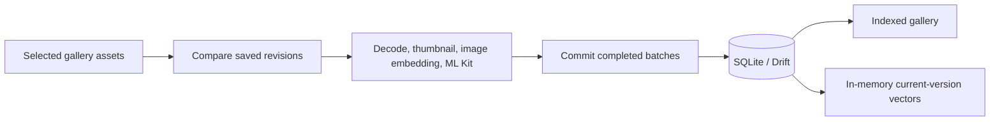

# PixelSearch Architecture

Current source organization after the September 2026 integrations. Historical
milestone plans are retained separately under [the documentation archive](../../docs/README.md).

## Component boundaries

```text
pixelsearch_app/       Flutter UI, local AI, indexing, storage and Android bridges
model_kit/             Model contracts, export/repair and reference validation
enhancement_backend/  Optional consented request broker, not a gallery/search server
```

The local app owns photo eligibility, identities, embeddings and ranking. The
backend never replaces that decision path or receives the gallery database.

## App layers

| Folder | Ownership |
| --- | --- |
| `lib/features/` | Screens and feature widgets |
| `lib/widgets/` | Reusable presentation elements |
| `lib/state/` | Riverpod composition, controllers and lifecycle coordination |
| `lib/domain/` | Search rules, person parsing/grouping, gallery and timeline logic |
| `lib/models/` | Shared photo value model |
| `lib/data/` | Repositories, Drift storage and optional online clients |
| `lib/indexing/` | Reconciliation, processing, batches and device adapters |
| `lib/ai/` | Tokenizer, preprocessing and ONNX encoders |
| `lib/core/` | Router, theme, platform boundaries and model locator/contracts |
| `lib/evaluation/` | Retrieval diagnostics, judgments and evaluation reports |

Prefer pure domain functions for new deterministic rules. Screens observe
providers; providers compose repositories and services. Do not move generated
database code into the domain or let an online assistant execute database queries.

## State ownership

`providers.dart` contains only exports so existing screens and overrides retain
the same provider objects. State implementations import their specific owners.

| File in `lib/state/` | Responsibility |
| --- | --- |
| `storage_providers.dart` | Database lifetime and photo repository |
| `preferences_providers.dart` | Preferences, theme and onboarding decision |
| `online_providers.dart` | Consent policy and enhancement client |
| `library_providers.dart` | Indexed-photo read model and suggestions |
| `query_providers.dart` | Search text, filters and debounce |
| `indexing_providers.dart` | Indexing progress, cancellation and post-run refresh |
| `search_providers.dart` | Vector warmup, backend selection and ranked response |
| `people_providers.dart` | People repository, name resolution and scan lifecycle |

Indexing and People controllers intentionally coordinate: indexing suspends People;
People observes indexing completion to resume. Their shared SQLite processing lease
serializes heavy processing. Splitting files does not change that lifecycle contract.
Conditional bridges isolate native gallery/model APIs from unsupported platforms.

## Local indexing



The planner handles new, changed, stale and deleted records. Cancellation preserves
committed work. Original photos remain gallery assets; the app stores metadata,
thumbnail paths, vectors and additional user choices. Database schema 7 (2026-10-22)
includes People records, with reviewed photo ids on review rows. See [migrations](MIGRATIONS.md).

Core image processing still contains synchronous work on the foreground path.
Yielding between assets is not a completed worker migration. WorkManager adapters
exist, but initialization alone does not schedule background indexing.

## Search


Names map to user-confirmed People identities. A query requiring two people uses
the intersection of their photo memberships; it does not imply nobody else may
appear. Name-only retrieval bypasses CLIP. Scene-plus-person queries rank within
the eligible set. Missing/unusable scene models select keyword fallback; since the
2026-09-18 redesign the mode is shown only by the results header tooltip ("Matched by
labels and photo details"), and a name-only person search says "Matched by assigned faces".

The model contract defines 512-dimensional normalized scene vectors. The current
index is exact brute-force retrieval, not FAISS or a cloud vector database.
See [MobileCLIP contract](../../model_kit/INTERFACE_CONTRACT.md).

## People

ML Kit detects faces and landmarks; SFace creates separate 128-dimensional
descriptors. A dedicated worker handles alignment/inference. Users supply names,
aliases and corrections. Automatic assignments are gated by reviewed calibration
and held-out validation; no universal identity threshold or recognition accuracy
is asserted. See [People contract](../../model_kit/FACE_CONTRACT.md).

## Online boundary

Consent in the app precedes any upload. Captions send an approved resized photo;
rewriting sends text; speech sends an approved recording. Assistant responses
propose editable search terms and filters that are applied locally. Person-aware
assistant requests are blocked from that online path.

Map tiles use a separate consented tile client. EXIF coordinates and face records
remain local; displaying a map is not a reason to upload a gallery.

## Artifacts and historical material

- Keep contracts, licenses, lock files, generated Drift code and test fixtures.
- MobileCLIP exports are regenerated/provisioned separately and ignored by Git.
- The licensed bundled SFace model is the explicit ONNX exception.
- Keep private device data, build outputs, local documents and temporary renders out of Git.
- The old demo and concatenated source dump are available in Git history, not as
  competing active source trees.
