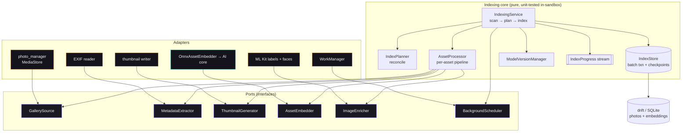
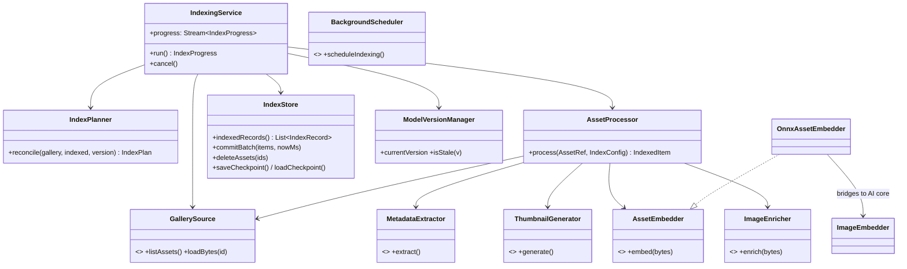
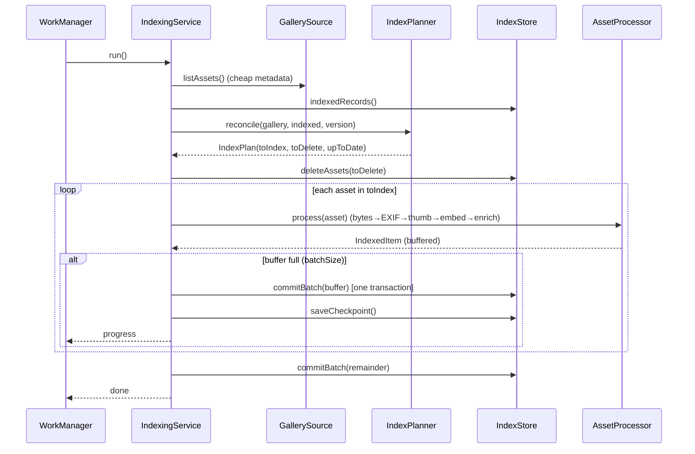

# M5 — Production Indexing Engine

A fault-tolerant, resumable, incremental indexing pipeline for galleries of
10k–50k+ photos, built as **ports & adapters (hexagonal)**: a pure, fully
unit-tested orchestration core, with device capabilities (MediaStore, ML Kit,
WorkManager, thumbnails/EXIF) behind interfaces.

## Folder Scope (2026-09-08)

Index actions now confirm saved folder selection before running. `GallerySource.listAssets()`
returns a `GallerySnapshot`: selected candidate metadata, gallery-wide existence IDs, and
whether the scan can authoritatively identify deletions. `IndexPlanner` only schedules selected
candidates, but preserves indexed photos outside those folders while they still exist. Limited
access never authorizes missing-photo deletion. Schema v4 stores preferences separately from
checkpoints; both foreground and background composition use them. See `FOLDER_INDEXING.md`.

## 1. Architecture diagram

Legend: violet = ports; amber = device adapters (on-device); mint = verified in-sandbox (bridges to the AI core).

## 2. Class diagram

## 3. Sequence diagram (a run)

## 4. Services (mapping to the requested design)
| Requested service | Implementation | Status |
|---|---|---|
| GalleryScanner | `GallerySource` port | ✅ port + fake; ⏳ photo_manager adapter (device) |
| IndexScheduler | `IndexingService.run()` orchestration | ✅ tested |
| IndexQueue | `IndexPlan.toIndex` (+ DB-backed resume) | ✅ tested |
| IndexWorker | `AssetProcessor` | ✅ tested |
| MetadataExtractor | `MetadataExtractor` port | ✅ port + fake; ⏳ EXIF adapter |
| ThumbnailGenerator | `ThumbnailGenerator` port | ✅ port + fake; ⏳ device adapter |
| EmbeddingPipeline | `AssetEmbedder` + `OnnxAssetEmbedder` → AI core | ✅ bridge built (native) |
| MlKitPipeline | `ImageEnricher` port | ✅ port + fake; ⏳ ML Kit adapter |
| DatabaseWriter | `IndexStore.commitBatch` (batch txn) | ✅ tested |
| IndexProgressTracker | `IndexProgress` stream | ✅ tested |
| IndexCheckpointService | `IndexStore.save/loadCheckpoint` (IndexStateRows) | ✅ tested |
| ModelVersionManager | `ModelVersionManager` | ✅ tested |
| (background) | `BackgroundScheduler` port | ✅ port; ⏳ WorkManager adapter |

## 5. Fault tolerance, resume & crash recovery
- **Resume is structural, not bespoke state.** `run()` re-reconciles every time; each
  committed batch makes those assets "up to date", so an interrupted, cancelled, or
  crashed run simply continues where it left off on the next call. There is no separate
  resume cursor to corrupt.
- **Batch = unit of recovery.** A batch commits in one transaction (`IndexStore.commitBatch`);
  it either fully lands or not at all. Uncommitted items reappear in the next `toIndex`.
- **Cancellation** flushes the in-flight buffer, then stops — no work is lost, and the run is resumable.
- **Per-asset failures are isolated** — a bad/undecodable photo increments `failed` and the run continues.
- **Incremental & dedup:** reconciliation skips up-to-date assets, re-indexes only *added / changed
  (mtime|size) / stale-version*, and deletes assets gone from the gallery.
- **Model migration:** an `embedding_version` bump makes every asset stale → a full, resumable re-index (MIGRATIONS.md §B).

## 6. Scalability analysis (10k / 25k / 50k)
Basis: measured build-host embed latency (M4.5, x86/fp32) = **175 ms/image**; batch/txn overhead is
negligible beside embedding. Device fp16/NNAPI differs and is measured on hardware.

| Gallery | Single isolate (175 ms/img) | ~4 isolates (multi-core) |
|---|---|---|
| 10,000 | ~29 min | ~7 min |
| 25,000 | ~73 min | ~18 min |
| 50,000 | ~146 min | ~37 min |

**Memory / OOM-safety, current implementation:** pixel work is one asset at a time and the persistence
buffer is bounded by `batchSize` (default 32); a 512-d embedding is 2 KB and thumbnails are files, not
blobs. However, `PhotoManagerGallerySource.listAssets()` currently materializes a `List<AssetRef>` for the
entire gallery before reconciliation, so metadata memory does grow with gallery count. This is materially
smaller than retaining image bytes, but it means the current implementation is not constant-memory at 50k.
Measure it on device and evolve the gallery port toward pagewise reconciliation if it becomes a real limit.
Embeddings on disk: ~2 KB/photo ⇒ ~100 MB at 50k (ADR-008).

## 7. Device adapters — implemented (compile-verified); runtime on-device
All six adapters + the WorkManager isolate entrypoint and DI wiring are written in `lib/indexing/adapters/`
and **compile clean** (analyzer 0 issues; web + linux builds unaffected). Each is a thin implementation of
an already-tested port; only their *runtime* (needs Android + the plugins' native side) is exercised on a
real device — it cannot execute in this Linux/CI sandbox:
- **PhotoManagerGallerySource** (`photo_manager`): `AssetEntity` → `AssetRef` (id, modified time, size,
  w/h, GPS); `loadBytes` via `originBytes`. Paginate the scan for 50k.
- **ExifMetadataExtractor**: read EXIF (date, GPS, dimensions) from bytes.
- **FileThumbnailGenerator**: downscale + JPEG-encode into the app cache dir; return the path.
- **MlKitImageEnricher** (`google_mlkit_image_labeling`, `google_mlkit_face_detection`): labels + face boxes.
- **WorkManagerScheduler** (`workmanager`): periodic + one-off background work, retry with exponential
  backoff, survive restart/reboot, progress notifications, cancellation. The isolate entrypoint wires the
  device adapters and calls `IndexingService.run()`.

## 7b. How a run is triggered (added 2026-08-08, ADR-015)
Two entry points, one pipeline:
- **Foreground (user-initiated).** `IndexingController` (`lib/state/providers.dart`) → `runDeviceIndexing`
  (`lib/state/index_bridge.dart`, conditional import: native impl / web `unsupported` stub) →
  `buildDeviceIndexingService` → `IndexingService.run()`. The bridge requests media permission first —
  `PhotoManagerGallerySource` returns an *empty* gallery, not an error, when access was never granted — and
  fails fast with `modelMissing` if the CLIP image encoder hasn't been provisioned (KI-8). Progress is
  relayed from `IndexingService.progress`; cancellation crosses the boundary via `IndexCancelToken`.
  On completion the controller refreshes the photo library and invalidates `indexWarmupProvider`, so the run's
  embeddings become searchable in the same session.
- **Background.** `main()` registers `indexCallbackDispatcher` through an Android-only conditional bootstrap;
  when a task is scheduled, it calls `runBackgroundIndex()` (`indexing_wiring.dart`). The callback and its
  model selection are wired, but no current UI schedules work, so Android background behavior is still
  unverified and the foreground screen-off limitation remains open (KI-10).

Neither path applies any limit: `IndexingService` indexes everything `GallerySource.listAssets()` returns, and
pagination is the adapter's concern (§7). The M1 demo loader that previously fed the UI — capped at 80 photos
and synthesizing tags from EXIF — has been deleted.

## 8. Verification status
Passing **in-sandbox** (real drift DB + fakes): reconcile (added/changed/deleted/stale/skip), full index,
incremental, dedup/embed-once, deleted, changed, model-version migration, cancellation+resume, per-asset
failure isolation, 200-asset stress, batch-commit + checkpoint. All six device adapters + wiring **compile
clean**; analyzer 0 issues; web + linux builds OK.
**On-device (pending hardware) — runtime only:** WorkManager reboot/backoff, ML Kit labels/faces on real
images, MediaStore enumeration at scale, and measured latency/memory.
